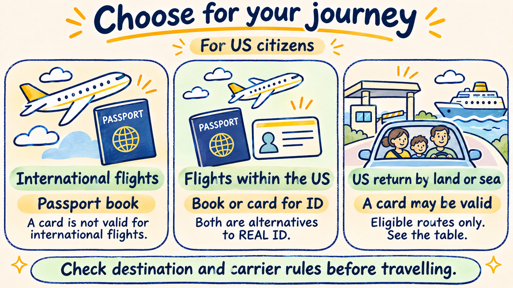

# U.S. Passport Card vs. Passport Book: Which Does Your Family Need? | Travel Document Vault

---

## Key Takeaways

- **Flying abroad means taking a passport book.** A US passport card is not valid for international flights.
- **A card has a narrower job.** It covers eligible US land and sea re-entry from Canada, Mexico, Bermuda and some Caribbean destinations, plus identification for US domestic flights.
- **Cruise rules need a separate check.** A qualifying closed-loop cruise has US-entry exceptions, but the cruise line or destination may require a book.
- **Choose for each person and each leg.** Children have specific exceptions. Passport copies do not replace a book or card; rules accepting copies of specified citizenship evidence are separate.

Choose for the journey you are actually taking, including the way home. A family driving to Canada has different decisions to make from one flying overseas or boarding a cruise.

## Book or card: start with your journey

The [US State Department's comparison](https://travel.state.gov/en/passports/apply/help/passport-card-vs-book.html) makes the main distinction clear: books support international air, land and sea travel; cards have a more limited role. The table below applies that distinction to family journeys. Its final column explains the conditions that a simple yes or no would miss.

For US citizens. The table below gives the route limits, cruise exceptions and children's provisions. Open the illustration to read it at full size.

| Your journey | Passport book | Passport card | What to check |
|---|---|---|---|
| International flights (outbound or return) | Valid for international air travel | Not valid | A book supports international flying, though destination entry and visa rules still apply. |
| Land or sea entry to the US from Canada, Mexico, Bermuda and some Caribbean destinations | Valid for international land and sea travel | Valid for US re-entry from these areas | Covers US land or sea entry from listed areas only. Check outbound destination rules separately. |
| Qualifying Western Hemisphere closed-loop cruise (same ship, same US port) | Valid, and recommended by State Department | Only for eligible US sea re-entry routes; not every Western Hemisphere cruise. | The closed-loop citizenship-evidence exception and passport-card eligibility are separate rules. Check the itinerary, cruise line and foreign ports; a flight home needs a book. |
| US domestic flights | Accepted instead of REAL ID | Accepted instead of REAL ID | Applies to US domestic air travel only, not international flights. |
| Canadian domestic flights | Supports international travel; confirm carrier ID rules | Cannot be used | State Department Canada guidance notes a US passport card cannot be used on Canadian domestic flights. |
| Unexpected international flight home from a road trip or cruise | Valid for international air travel | Not valid | A card that worked by car or ship will not get you onto an international flight back to the US. |

This comparison concerns US citizens using US documents. If someone in your family travels on another country's passport, keep their document check separate rather than copying the US-citizen row. Start with the guidance for their citizenship and actual route, including their return to the US.

Read the row for your outward journey, then read the one for your return. A document that works at a land border is not necessarily enough at an airport. If a flight is part of the plan, write down whether it stays within the US or crosses an international border.

For a family choosing one format for varied travel, we'd start with passport books. You may have other document options for a road trip or cruise, depending on the route. It leaves you fewer document decisions to revisit when a future holiday involves flying.

## Driving to Canada? Check both borders

Picture a family driving into Canada and returning by car. There are two sets of entry rules to check: Canada's on the way in and US rules on the way home. The [State Department's Canada guidance](https://travel.state.gov/en/international-travel/travel-advisories/canada.html) lists a valid US passport, passport card or NEXUS card for US-citizen entry by land.

Children need their own document check. [US border regulations, 8 CFR 235.1](https://www.ecfr.gov/current/title-8/chapter-I/subchapter-B/part-235/section-235.1) allow US citizens under 16 returning by land or sea from contiguous territory to use specified alternative citizenship evidence. That provision covers US re-entry only. It does not establish what Canada requires for the outward trip.

Now change one part of the plan: the family drives out but flies home. The card no longer covers that international flight. Canada guidance also says a US passport card cannot be used for domestic flights within Canada, so do not assume the US domestic-flight rule applies there.

Write down whether a flight is a realistic alternative before choosing documents around the simplest border crossing. With a passport book, you can plan for an international flight home as well as the land crossing, while still checking the journey's other requirements.

## Taking a cruise? Check the ship's rules too

A cruise booking is where the phrase "you don't need a passport" needs closer attention. The US closed-loop exception is specific: US citizens travelling within the Western Hemisphere, departing and returning on **the same ship at the same US port**. A sailing outside those conditions does not qualify for that exception.

For a qualifying cruise, the regulation allows specified citizenship evidence with government-issued photo ID for US re-entry. The listed evidence includes an original or copy of a birth certificate, Consular Report of Birth Abroad or Certificate of Naturalization. Under-16s have a separate provision. Use the exact rule for each traveller.

That answers the US border question, but it does not settle the whole cruise. Your ship and the countries on its itinerary can have their own requirements. The [State Department's cruise guidance](https://travel.state.gov/en/international-travel/planning/safety-tips/cruise-ships.html) says a cruise company may require a passport book even where border authorities do not.

The State Department also recommends taking a book in case you need to fly home unexpectedly. We'd follow that advice for a family cruise abroad, checking the requirements against the actual booking rather than what worked for a friend's sailing.

## Flying within the US? Either can serve as ID

A passport card is not valid for international flying, but that does not mean it has no use at an airport. The State Department lists **both the book and card** as alternatives to REAL ID for US domestic air travel. Before choosing your airport ID, look at where the flight goes.

For someone who already has a book, a card may be useful as a separate wallet-sized ID. That is a reason to consider one. It does not mean every family member needs both, particularly when a book alone covers the role you want from a passport.

## Does your family need both?

Choose for the trips you expect to take: a book is the straightforward starting point for international flights. A card may suit frequent eligible land crossings or US domestic identification; carrying both can make sense when you have a clear use for each.

There is little value in adding a second format just because it appears on the application form. Who will carry it? When will they use it? For a child travelling with you, the answer may differ from an adult who regularly crosses a land border.

Consider a household where one parent regularly drives across the Canadian border and the rest of the family travels internationally by air. The parent might choose a card as well as a book, while the other travellers choose books. Their different routes explain their different choices. Write the reason for each choice beside that person's name, such as 'international flights' or 'frequent land crossings', so you can revisit it when a new trip has a different route.

Check the State Department's current application guidance and fees before applying. In particular, do not assume a child's application follows an adult renewal process; use the guidance for that child's age and circumstances.

If a child's document needs replacing, our guide to [US passport applications for children under 16](/blog/us-child-passport-renewal-under-16/) explains that separate task. When one parent is travelling with children, the [child travel consent letter guide](/blog/child-travel-consent-letter/) is another useful part of the preparation.

## Make a document list for each traveller

Put the physical documents on the table and make one row per person. Keep the outward and return journeys beside each other on a list short enough to use while packing. Then decide which document goes in each person's bag. That is more useful than a family-wide note saying "passports sorted".

- Record each traveller's citizenship and, for children, age.
- Write down the outward route, return route and any realistic flight-home alternative.
- List the original documents needed for those legs and check their expiry dates.
- Note any destination or carrier requirements you still need to confirm.
- Keep backup copies separately from the originals.

Try the list against a change of plan before you pack. Suppose you drive out, then consider a flight home: which rows now need attention? Work through the question for each traveller, rather than changing only the adults' entries.

Once the documents match the route, put them where you can reach them at the relevant check. Before leaving, show the other adult travelling with you where you've packed the originals and give them a copy of the list.

The State Department recommends separate passport copies and a saved phone photo before a cruise. Those records can help if a document goes missing; they do not replace a physical passport book or card for travel. Specific US-entry exceptions can separately accept copies of certain citizenship documents, which is a different rule from travelling on a passport scan.

If you use [Travel Document Vault](/) for document records and expiry dates, keep those records alongside your family's list. Carry the physical documents your journey requires, with backup copies kept separately.

Our guides to [digital passport copies](/blog/digital-passport-copy-valid/) and [family passport management](/blog/family-passport-management/) cover that part in more detail. For this decision, start with one task: write down every leg of the trip for every person, then choose the documents that cover it.

## Frequently Asked Questions

### Can US citizens fly to Canada or Mexico with a US passport card?

No. A US passport card is not valid for international air travel, including flights to or from Canada, Mexico, Bermuda or the Caribbean. US citizens flying internationally need a valid US passport book and must satisfy the destination country's entry requirements.

### Can you use a US passport card for US domestic flights?

Yes. The US State Department confirms that both a valid US passport book and a valid US passport card serve as identification for US domestic flights instead of REAL ID. That acceptance covers US domestic flights only, not international flights or Canadian domestic flights.

### Do you need a passport book for a closed-loop cruise from the United States?

US citizens on a qualifying Western Hemisphere cruise returning on the same ship to the same US port may use specified citizenship evidence and government photo ID under 8 CFR 235.1(b)(5), with a separate under-16 provision. Passport cards have their own eligible land and sea US-entry scope under paragraph (b)(1); the closed-loop exception does not extend that scope. Your cruise line or a foreign port may require a book, and the State Department recommends one for an unexpected flight home.

### Do children under 16 need a passport to drive to Canada and return to the United States?

US border regulations allow US-citizen children under 16 returning by land or sea from contiguous territory to use specified alternative citizenship evidence. That covers US re-entry, so check Canada's requirements for the outward journey separately. A passport card is not valid for international flights or domestic flights within Canada; consult the carrier's accepted-ID requirements for any flight you add.

### Does every family member need both a passport book and a passport card?

No. US citizens can choose a passport book, a passport card or both. A passport book alone handles international air, land and sea travel as well as US domestic flight identification, while adding a card mainly suits travellers who want a separate wallet-sized ID for frequent eligible land crossings or US domestic flights.

Official sources

- [US State Department: Passport Card vs. Passport Book](https://travel.state.gov/en/passports/apply/help/passport-card-vs-book.html)
- [US State Department: Cruise Ship Passengers](https://travel.state.gov/en/international-travel/planning/safety-tips/cruise-ships.html)
- [US eCFR: 8 CFR 235.1 (Scope of examination)](https://www.ecfr.gov/current/title-8/chapter-I/subchapter-B/part-235/section-235.1)
- [US State Department: Canada International Travel Information](https://travel.state.gov/en/international-travel/travel-advisories/canada.html)

## Related Articles

[Family Travel7 min read · July 2026Family Passport Management: Store Multiple Passports Safely](/blog/family-passport-management/)

[Passport RulesNovember 3, 2026Can You Renew a US Child's Passport? No, You Apply Again](/blog/us-child-passport-renewal-under-16/)
