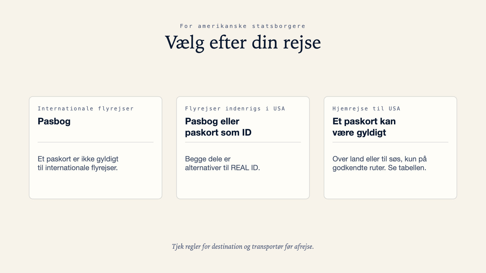

# Paskort eller pasbog fra USA: hvad har din familie brug for? | Travel Document Vault

---

## Hovedpunkter

- **Flyrejser til udlandet kræver en pasbog.** Et amerikansk paskort er ikke gyldigt til internationale flyrejser.
- **Et paskort har et mere begrænset anvendelsesområde.** Det dækker godkendt genindrejse til USA over land og til søs fra Canada, Mexico, Bermuda og visse caribiske destinationer samt legitimation til amerikanske indenrigsflyvninger.
- **Krydstogtsregler kræver et særskilt tjek.** Et krydstogt, der vender tilbage til samme havn (closed-loop) og opfylder betingelserne, er omfattet af undtagelser ved indrejse til USA, men rederiet eller destinationen kan kræve en pasbog.
- **Vælg for hver person og hver delstrækning.** Børn har særlige undtagelser. Paskopier erstatter ikke en pasbog eller et paskort; regler, der accepterer kopier af nærmere angivne beviser for statsborgerskab, er særskilte.

Vælg ud fra den rejse, du faktisk skal på, inklusive hjemrejsen. En familie, der kører til Canada, står over for andre valg end en familie, der flyver oversøisk eller tager på krydstogt.

## Pasbog eller paskort: start med din rejse

Det [amerikanske udenrigsministeriums sammenligning](https://travel.state.gov/en/passports/apply/help/passport-card-vs-book.html) gør den vigtigste forskel tydelig: pasbøger kan bruges til internationale rejser med fly, over land og til søs, mens paskort har en mere begrænset rolle. Tabellen nedenfor omsætter denne forskel til familierejser. Den sidste kolonne forklarer de betingelser, som et simpelt ja eller nej ville overse.

For amerikanske statsborgere. Sammenlign hver delstrækning af rejsen med den detaljerede tabel, herunder rutebegrænsninger, krydstogtsundtagelser og bestemmelser for børn.

| Din rejse | Pasbog | Paskort | Hvad du skal tjekke |
|---|---|---|---|
| Internationale flyrejser (udrejse eller hjemrejse) | Gyldig til internationale flyrejser | Ikke gyldigt | En pasbog kan bruges til internationale flyrejser, men destinationslandets indrejse- og visumregler gælder stadig. |
| Indrejse til USA over land eller til søs fra Canada, Mexico, Bermuda og visse caribiske destinationer | Gyldig til internationale rejser over land og til søs | Gyldigt til genindrejse til USA fra disse områder | Dækker kun indrejse til USA over land eller til søs fra de nævnte områder. Tjek udrejsedestinationens regler særskilt. |
| Krydstogt på den vestlige halvkugle, der opfylder closed-loop-betingelserne (samme skib, samme amerikanske havn) | Gyldig og anbefalet af det amerikanske udenrigsministerium | Kun til godkendte ruter for genindrejse til USA til søs; ikke alle krydstogter på den vestlige halvkugle. | Closed-loop-undtagelsen for statsborgerskabsbevis og reglerne for brug af paskort er særskilte regler. Tjek rejseruten, rederiet og udenlandske havne; en flyrejse hjem kræver en pasbog. |
| Amerikanske indenrigsflyvninger | Accepteres i stedet for REAL ID | Accepteres i stedet for REAL ID | Gælder kun amerikanske indenrigsflyvninger, ikke internationale flyrejser. |
| Canadiske indenrigsflyvninger | Kan bruges til internationale rejser; tjek flyselskabets ID-regler | Kan ikke bruges | Det amerikanske udenrigsministeriums vejledning om Canada bemærker, at et amerikansk paskort ikke kan bruges på canadiske indenrigsflyvninger. |
| Uventet international flyrejse hjem fra en biltur eller et krydstogt | Gyldig til internationale flyrejser | Ikke gyldigt | Et paskort, der fungerede i bil eller med skib, giver dig ikke adgang til et internationalt fly tilbage til USA. |

Denne sammenligning gælder amerikanske statsborgere, der rejser med amerikanske dokumenter. Hvis nogen i din familie rejser på et andet lands pas, skal du tjekke deres dokumenter særskilt i stedet for at bruge rækken for amerikanske statsborgere. Start med vejledningen for deres statsborgerskab og faktiske rute, inklusive hjemrejsen til USA.

Læs rækken for din udrejse, og læs derefter rækken for din hjemrejse. Et dokument, der fungerer ved en landegrænse, er ikke nødvendigvis nok i en lufthavn. Hvis en flyvning indgår i planen, bør du skrive ned, om den foregår inden for USA eller krydser en international grænse.

For en familie, der vælger ét format til varierede rejser, ville vi starte med pasbøger. Du kan have andre dokumentmuligheder til en biltur eller et krydstogt, afhængigt af ruten. Det giver dig færre dokumentbeslutninger at genoverveje, når en fremtidig ferie involverer flyrejser.

## Kører du til Canada? Tjek begge grænser

Forestil dig en familie, der kører til Canada og kører hjem igen i bil. Der er to sæt indrejseregler at tjekke: Canadas på udrejsen og USA's regler på hjemrejsen. Det [amerikanske udenrigsministeriums vejledning om Canada](https://travel.state.gov/en/international-travel/travel-advisories/canada.html) angiver et gyldigt amerikansk pas, et paskort eller et NEXUS-kort for amerikanske statsborgeres indrejse over land.

Tjek også hvert barns dokumenter særskilt. [De amerikanske grænseregler (8 CFR 235.1)](https://www.ecfr.gov/current/title-8/chapter-I/subchapter-B/part-235/section-235.1) giver amerikanske statsborgere under 16 år, der vender tilbage over land eller til søs fra tilgrænsende territorium, mulighed for at bruge nærmere angivne alternative beviser for statsborgerskab. Den bestemmelse gælder kun genindrejse til USA. Den fastlægger ikke, hvad Canada kræver på udrejsen.

Ændr nu én del af planen: familien kører ud, men flyver hjem. Paskortet dækker ikke længere den internationale flyrejse. Vejledningen om Canada siger også, at et amerikansk paskort ikke kan bruges til indenrigsflyvninger i Canada, så gå ikke ud fra, at den amerikanske indenrigsregel gælder dér.

Skriv ned, om en flyrejse er et realistisk alternativ, før du vælger dokumenter ud fra den simpleste grænseovergang. Med en pasbog kan du planlægge både en international flyrejse hjem og grænseovergangen over land, mens du stadig tjekker rejsens øvrige krav.

## Skal du på krydstogt? Tjek også skibets regler

Ved en krydstogtsbooking kræver udtrykket "du behøver ikke pas" ekstra opmærksomhed. Den amerikanske closed-loop-undtagelse er specifik: amerikanske statsborgere, der rejser på den vestlige halvkugle med afrejse og hjemkomst med **det samme skib i den samme amerikanske havn**. En sejlads uden for disse betingelser er ikke omfattet af undtagelsen.

Ved et krydstogt, der opfylder betingelserne, tillader reglerne nærmere angivne beviser for statsborgerskab sammen med offentligt udstedt billedlegitimation til genindrejse til USA. De angivne beviser omfatter en original eller kopi af en fødselsattest, en konsulær rapport om fødsel i udlandet (Consular Report of Birth Abroad) eller et naturalisationsbevis (Certificate of Naturalization). Personer under 16 år er omfattet af en særskilt bestemmelse. Brug den nøjagtige regel for hver rejsende.

Det besvarer spørgsmålet om den amerikanske grænse, men det afklarer ikke alle krav til krydstogtet. Dit skib og landene på ruten kan have deres egne krav. Det [amerikanske udenrigsministeriums krydstogtsvejledning](https://travel.state.gov/en/international-travel/planning/safety-tips/cruise-ships.html) oplyser, at et krydstogtsrederi kan kræve en pasbog, selv når grænsemyndighederne ikke gør.

Det amerikanske udenrigsministerium anbefaler også at medbringe en pasbog, hvis du får brug for at flyve uventet hjem. Vi ville følge det råd på et familiekrydstogt til udlandet og tjekke kravene ud fra den konkrete booking frem for, hvad der fungerede på en vens sejlads.

## Flyver du indenrigs i USA? Begge dele kan bruges som ID

Et paskort er ikke gyldigt til internationale flyrejser, men det betyder ikke, at det ikke kan bruges i en lufthavn. Det amerikanske udenrigsministerium angiver **både pasbogen og paskortet** som alternativer til REAL ID ved amerikanske indenrigsflyvninger. Før du vælger legitimation til lufthavnen, bør du se på, hvor flyet skal hen.

For en person, der allerede har en pasbog, kan et paskort være praktisk som et separat ID i pungstørrelse. Det er en grund til at overveje et. Det betyder ikke, at alle i familien har brug for begge dele, især når en pasbog alene dækker det behov, du har for et pas.

## Har din familie brug for begge dele?

Vælg ud fra de rejser, du forventer at tage på: en pasbog er det enkleste udgangspunkt til internationale flyrejser. Et paskort kan passe til hyppige grænsepassager over land på godkendte ruter eller som legitimation på amerikanske indenrigsflyvninger; det kan give mening at have begge dele, når du har et tydeligt formål med hver af dem.

Der er begrænset værdi i at tilføje endnu et format, blot fordi det står på ansøgningsblanketten. Hvem skal have det med? Hvornår skal vedkommende bruge det? For et barn, der rejser med dig, kan svaret være anderledes end for en voksen, der jævnligt krydser en landegrænse.

Tænk på en husstand, hvor den ene forælder jævnligt kører over den canadiske grænse, mens resten af familien rejser internationalt med fly. Den forælder kan vælge et paskort ud over en pasbog, mens de øvrige rejsende vælger pasbøger. Deres forskellige ruter forklarer deres forskellige valg. Skriv begrundelsen for hvert valg ved siden af personens navn, såsom "internationale flyrejser" eller "hyppige landgrænseovergange", så du kan genoverveje det, når en ny rejse har en anden rute.

Tjek det amerikanske udenrigsministeriums gældende ansøgningsvejledning og gebyrer, før du søger. Gå især ikke ud fra, at et barns ansøgning følger fornyelsesprocessen for voksne; brug vejledningen for barnets alder og konkrete forhold.

Hvis et barns dokument skal erstattes, gennemgår vores guide til [amerikanske pasansøgninger for børn under 16 år](/da/blog/us-child-passport-renewal-under-16/) den særskilte proces. Når én forælder rejser med børn, er [guiden om samtykkeerklæring til børns rejser](/da/blog/child-travel-consent-letter/) en anden nyttig del af forberedelsen.

## Lav en dokumentliste for hver rejsende

Læg de fysiske dokumenter på bordet, og lav én række pr. person. Stil udrejsen og hjemrejsen ved siden af hinanden på en liste, der er kort nok til at bruge, mens du pakker. Beslut derefter, hvilket dokument der skal i hver persons taske. Det er mere brugbart end en fælles familienote med teksten "pas i orden".

- Notér hver rejsendes statsborgerskab og, for børn, alder.
- Skriv udrejseruten, hjemrejseruten og eventuelle realistiske muligheder for at flyve hjem som alternativ.
- Skriv de originale dokumenter ned, der kræves på disse delstrækninger, og tjek deres udløbsdatoer.
- Notér eventuelle krav fra destinationen eller transportøren, som du stadig mangler at få bekræftet.
- Opbevar sikkerhedskopier adskilt fra originalerne.

Afprøv listen mod en planændring, før du pakker. Forestil dig, at I kører ud, og overvej derefter en flyrejse hjem: hvilke rækker kræver nu opmærksomhed? Gå spørgsmålet igennem for hver rejsende i stedet for kun at ændre de voksnes linjer.

Når dokumenterne passer til ruten, så læg dem et sted, hvor du kan nå dem ved den relevante kontrol. Inden afrejse bør du vise den anden voksne, der rejser med, hvor du har pakket originalerne, og give vedkommende en kopi af listen.

Det amerikanske udenrigsministerium anbefaler separate paskopier og et gemt foto på telefonen inden et krydstogt. Disse oplysninger kan hjælpe, hvis et dokument bliver væk; de erstatter ikke en fysisk pasbog eller et fysisk paskort ved rejse. Særlige undtagelser ved indrejse til USA kan særskilt acceptere kopier af bestemte statsborgerskabsdokumenter, hvilket er en anden regel end at rejse på en scanning af et pas.

Hvis du bruger [Travel Document Vault](/da/) til dokumentoplysninger og udløbsdatoer, kan du have disse oplysninger ved siden af familiens liste. Medbring de fysiske dokumenter, din rejse kræver, og opbevar sikkerhedskopier adskilt fra dem.

Vores guides om [digitale paskopier](/da/blog/digital-passport-copy-valid/) og [håndtering af familiens pas](/da/blog/family-passport-management/) gennemgår den del mere indgående. Til denne beslutning kan du starte med én opgave: skriv hver delstrækning af rejsen ned for hver person, og vælg derefter de dokumenter, der dækker den.

## Ofte stillede spørgsmål

### Kan amerikanske statsborgere flyve til Canada eller Mexico med et amerikansk paskort?

Nej. Et amerikansk paskort er ikke gyldigt til internationale flyrejser, herunder flyvninger til eller fra Canada, Mexico, Bermuda eller Caribien. Amerikanske statsborgere, der flyver internationalt, har brug for en gyldig amerikansk pasbog og skal opfylde destinationslandets indrejsekrav.

### Kan man bruge et amerikansk paskort til amerikanske indenrigsflyvninger?

Ja. Det amerikanske udenrigsministerium bekræfter, at både en gyldig amerikansk pasbog og et gyldigt amerikansk paskort fungerer som legitimation på amerikanske indenrigsflyvninger i stedet for REAL ID. Denne accept gælder kun amerikanske indenrigsflyvninger, ikke internationale flyrejser eller canadiske indenrigsflyvninger.

### Har man brug for en pasbog til et krydstogt fra USA, der vender tilbage til samme havn (closed-loop)?

Amerikanske statsborgere på et krydstogt, der opfylder betingelserne, på den vestlige halvkugle, som vender tilbage med det samme skib til den samme amerikanske havn, kan bruge nærmere angivne beviser for statsborgerskab og offentligt udstedt billedlegitimation i henhold til 8 CFR 235.1(b)(5), med en særskilt bestemmelse for personer under 16 år. Paskort har deres eget godkendte gyldighedsområde for indrejse til USA over land og til søs efter afsnit (b)(1); closed-loop-undtagelsen udvider ikke dette område. Dit krydstogtsrederi eller en udenlandsk havn kan kræve en pasbog, og det amerikanske udenrigsministerium anbefaler en pasbog i tilfælde af en uventet flyrejse hjem.

### Skal børn under 16 år have pas for at køre til Canada og vende tilbage til USA?

Amerikanske grænseregler giver børn under 16 år med amerikansk statsborgerskab, der vender tilbage over land eller til søs fra tilgrænsende territorium, mulighed for at bruge nærmere angivne alternative beviser for statsborgerskab. Det gælder genindrejse til USA, så tjek Canadas krav til udrejsen særskilt. Et paskort er ikke gyldigt til internationale flyrejser eller indenrigsflyvninger i Canada; tjek flyselskabets krav til godkendt legitimation for enhver flyvning, du tilføjer.

### Har alle i familien brug for både en pasbog og et paskort?

Nej. Amerikanske statsborgere kan vælge en pasbog, et paskort eller begge dele. En pasbog alene dækker internationale rejser med fly, over land og til søs samt legitimation til amerikanske indenrigsflyvninger, mens et paskort som supplement primært passer til rejsende, der ønsker et separat ID i pungstørrelse til hyppige godkendte grænseovergange over land eller amerikanske indenrigsflyvninger.

Officielle kilder

- [US State Department: Passport Card vs. Passport Book](https://travel.state.gov/en/passports/apply/help/passport-card-vs-book.html)
- [US State Department: Cruise Ship Passengers](https://travel.state.gov/en/international-travel/planning/safety-tips/cruise-ships.html)
- [US eCFR: 8 CFR 235.1 (Scope of examination)](https://www.ecfr.gov/current/title-8/chapter-I/subchapter-B/part-235/section-235.1)
- [US State Department: Canada International Travel Information](https://travel.state.gov/en/international-travel/travel-advisories/canada.html)

## Relaterede artikler

[Familierejser7 min. læsetid · juli 2026Håndtering af familiens pas: opbevar flere pas sikkert](/da/blog/family-passport-management/)

[Pasregler3. november 2026Kan man forny et amerikansk børnepas? Nej, man søger på ny](/da/blog/us-child-passport-renewal-under-16/)
