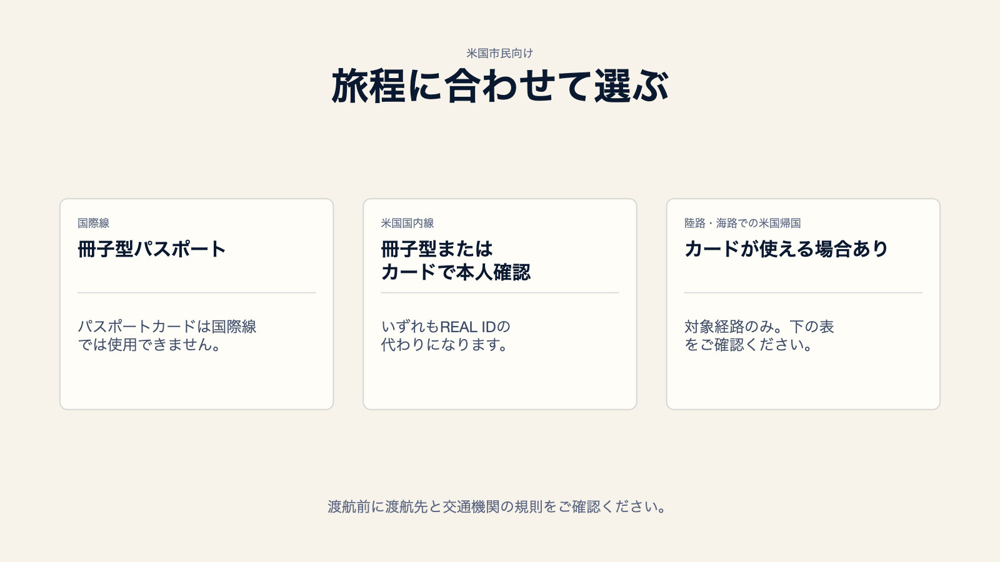

# 米国パスポートカードと冊子型パスポートの比較：ご家族に必要なのはどちら？ | Travel Document Vault

---

## 要点まとめ

- **海外へ空路で渡航する場合は冊子型パスポートをお持ちください。** 米国パスポートカードは国際線では使用できません。
- **パスポートカードの用途はより限定的です。** カナダ、メキシコ、バミューダおよび一部のカリブ海地域から陸路または海路で米国へ再入国する対象経路と、米国国内線の本人確認に対応します。
- **クルーズの規則は別途確認が必要です。** 条件を満たすクローズドループ・クルーズには米国入国時の例外がありますが、クルーズ会社や寄港地が冊子型パスポートを求める場合があります。
- **同行者ごと、そして行程ごとに書類を選びましょう。** お子さまには個別の例外規定があります。パスポートのコピーは冊子型パスポートやパスポートカードの代わりにはなりません。所定の市民権証明書類のコピーを認める規定とは別の扱いになります。

帰国の経路も含め、実際に予定している旅程に合わせて書類を選びましょう。車でカナダへ行くご家族と、空路で海外へ渡航したりクルーズに乗船したりするご家族では、判断のポイントが異なります。

## 冊子型かカードか：まずは旅程から確認する

まず、 [米国国務省の比較案内](https://travel.state.gov/en/passports/apply/help/passport-card-vs-book.html) では主な違いが明確に示されています。冊子型パスポートは空路・陸路・海路の国際渡航に対応しており、パスポートカードの役割はより限定的です。下の表では、この違いをご家族のさまざまな旅程に当てはめて整理しています。右端の列では、単純な可否だけでは見落としがちな条件を説明しています。

米国市民向け。経路の制限、クルーズの例外規定、お子さまに関する規定を含め、旅程のすべての区間を詳細な表で比較してください。

| 旅程 | 冊子型パスポート | パスポートカード | 確認すべき点 |
|---|---|---|---|
| 国際線（往路・復路） | 国際線での渡航に有効 | 使用不可 | 冊子型パスポートは国際線での渡航に対応しますが、渡航先の入国要件やビザ規則は別途適用されます。 |
| カナダ、メキシコ、バミューダおよび一部のカリブ海地域から陸路または海路での米国入国 | 陸路・海路の国際渡航に有効 | 対象地域からの米国再入国に有効 | 記載地域から陸路または海路で米国へ入国する場合のみ対象です。往路における渡航先の入国規則は別途ご確認ください。 |
| 条件を満たす西半球のクローズドループ・クルーズ（同じ船・同じ米国の港） | 有効（米国国務省も推奨） | 海路での米国再入国の対象経路のみ。すべての西半球クルーズが対象ではありません。 | クローズドループの市民権証明書類に関する例外規定と、パスポートカードの利用対象は別の規則です。航程、クルーズ会社、外国の寄港地の要件をご確認ください。空路で帰国する場合は冊子型パスポートが必要です。 |
| 米国国内線 | REAL IDの代替として有効 | REAL IDの代替として有効 | 米国国内線のみに適用され、国際線には適用されません。 |
| カナダ国内線 | 国際渡航に対応（航空会社の本人確認規定を確認） | 使用不可 | 米国国務省のカナダ渡航案内では、米国パスポートカードはカナダ国内線で使用できないと明記されています。 |
| ドライブ旅行やクルーズ先からの予期しない国際線での帰国 | 国際線での渡航に有効 | 使用不可 | 車や船での移動に使えたパスポートカードであっても、米国へ戻る国際線には搭乗できません。 |

この比較は、米国の書類を使用する米国市民を対象としています。ご家族の中に他国のパスポートで渡航する方がいる場合は、米国市民向けの行をそのまま当てはめず、別個に書類を確認してください。その方の国籍と、米国への帰国を含む実際の経路に応じた案内から確認を始めましょう。

まず往路に該当する行を読み、次に復路に該当する行を確認してください。陸路の国境で通用する書類であっても、空港で十分とは限りません。旅程に飛行機が含まれる場合は、米国国内にとどまる便か国境を越える国際線かを書き出しておきましょう。

さまざまな旅行に対応できる形式を1つ選ぶなら、ご家族にはまず冊子型パスポートをおすすめします。経路によってはドライブ旅行やクルーズで別の書類を使える場合もありますが、冊子型を選んでおけば、将来の休暇で飛行機を利用する際に見直す項目を減らせます。

## カナダへ車で渡航する場合：往復両方の国境規則を確認する

ご家族で車に乗ってカナダへ入国し、同じく車で帰国する場合を想像してみてください。確認すべき入国規則は2つあります。往路のカナダ側の規則と、復路の米国側の規則です。なお、 [米国国務省のカナダ渡航案内](https://travel.state.gov/en/international-travel/travel-advisories/canada.html) では、米国市民が陸路で入国する際に使える書類として、有効な米国の冊子型パスポート、パスポートカード、またはNEXUSカードを挙げています。

お子さまの書類は別途確認する必要があります。 [米国国境規則（8 CFR 235.1）](https://www.ecfr.gov/current/title-8/chapter-I/subchapter-B/part-235/section-235.1) では、隣接地域から陸路または海路で帰国する16歳未満の米国市民について、所定の代替市民権証明書類の使用を認めています。ただし、この規定が対象とするのは米国への再入国のみであり、往路でカナダ側が求める要件を定めるものではありません。

ここで計画を一つだけ変えて、往路は車で出発し、復路は飛行機で帰国する場合を考えてみましょう。この国際線ではパスポートカードは使えません。さらに、米国国務省のカナダ渡航案内では、米国パスポートカードはカナダ国内線でも使用できないとされています。米国国内線でのルールがそのまま当てはまると思い込まないようにしてください。

最も簡便な国境通過に合わせて書類を決める前に、空路が現実的な選択肢になり得るかを書き出しておきましょう。冊子型パスポートがあれば、陸路での越境だけでなく国際線での帰国も見据えて計画できます。そのうえで、旅程に関わるその他の要件も忘れずに確認してください。

## クルーズに乗船する場合：船会社の規則も確認する

クルーズの予約では、「パスポートは不要」という言葉を慎重に確認する必要があります。米国のクローズドループ例外は条件が限定的で、対象となるのは西半球内を旅行し、 **出発した米国の港へ同じ船で戻る**米国市民です。この条件から外れる航程は例外の対象外となります。

条件を満たすクルーズでは、米国への再入国に際して、所定の市民権証明書類と公的機関発行の写真付き身分証明書の組み合わせが規則上認められています。対象書類には、出生証明書、海外出生領事報告書、または帰化証明書の原本もしくはコピーが含まれます。16歳未満には別の規定があるため、同行者ごとに正確な規則を確認してください。

これで米国国境での扱いは確認できますが、クルーズ全体の要件が解決するわけではありません。乗船するクルーズ会社や寄港する各国が独自の要件を定めている場合があります。実際、 [米国国務省のクルーズ渡航案内](https://travel.state.gov/en/international-travel/planning/safety-tips/cruise-ships.html) では、国境当局が求めていない場合でも、クルーズ会社が冊子型パスポートの提示を求めることがあると案内しています。

また米国国務省は、予期せず空路で帰国する必要が生じた場合に備えて冊子型パスポートを携行することも推奨しています。ご家族での海外クルーズではこの助言に従い、友人の乗船時の経験ではなく、ご自身の実際の予約内容に照らして要件を確認することをおすすめします。

## 米国国内線を利用する場合：どちらも身分証明書になる

パスポートカードは国際線では使用できませんが、空港でまったく役に立たないわけではありません。米国国務省は、米国国内線におけるREAL IDの代替として、 **冊子型パスポートとパスポートカードの両方** を挙げています。空港で使う身分証明書を選ぶ前に、搭乗する便の行き先を確認しましょう。

すでに冊子型パスポートをお持ちの方にとっては、財布に収まる別個の身分証明書としてパスポートカードが便利な場合があります。それはカードの取得を検討する一つの理由になりますが、冊子型パスポートだけで必要な役割を満たせる場合にまで、ご家族全員が両方を持つ必要はありません。

## ご家族全員に両方が必要？

今後予定している旅行に合わせて選びましょう。国際線を利用するなら、冊子型パスポートが迷いの少ない出発点です。対象となる陸路越境を頻繁に行う場合や米国国内線の本人確認用にはパスポートカードが向いており、それぞれに明確な使い道があるなら両方を持つ選択も理にかなっています。

申請書に選択肢が並んでいるからという理由だけで、2つ目の形式を追加してもあまり意味がありません。誰が携帯するのか、いつ使うのかを具体的に考えてみましょう。同行するお子さまと、陸路で国境を頻繁に越える大人とでは、適切な答えが異なる場合があります。

たとえば、保護者の1人がカナダ国境を車で頻繁に越え、他の家族は空路で海外旅行をするご家庭を考えてみましょう。その保護者は冊子型パスポートに加えてパスポートカードを選び、他の家族は冊子型パスポートのみを選ぶという判断ができます。経路の違いが選択の違いにつながります。それぞれの名前の横に「国際線利用」や「頻繁な陸路越境」のように選んだ理由を書き添えておくと、別の経路の旅行を計画する際にすぐ見直せます。

申請前には、米国国務省の最新の申請案内と手数料をご確認ください。特に、お子さまの申請が大人の更新手続きと同じだと思い込まないよう、年齢と状況に応じた案内を参照してください。

お子さまの書類を作り直す必要がある場合は、 [16歳未満のお子さまの米国パスポート申請ガイド](/ja/blog/us-child-passport-renewal-under-16/) で別の手続きとして詳しく解説しています。保護者1名がお子さまと渡航する場合は、 [子どもの渡航同意書ガイド](/ja/blog/child-travel-consent-letter/) も準備に役立ちます。

## 同行者ごとの書類リストを作成する

書類の原本をテーブルに並べ、1人につき1行のリストを作りましょう。荷造りしながら確認できる簡潔さにまとめ、往路と復路を隣り合わせに記載します。そのうえで、どの書類を誰のバッグに入れるかを決めます。「パスポート準備済み」と家族全員分をひとまとめにメモするよりずっと実用的です。

- 同行者それぞれの国籍と、お子さまの場合は年齢を記録する。
- 往路の経路、復路の経路、および現実的に想定される空路での帰国案を書き出す。
- 各行程に必要な書類の原本を一覧にし、有効期限を確認する。
- まだ確認が終わっていない渡航先や交通機関の要件をメモしておく。
- 控えのコピーは原本とは別の場所に保管する。

荷造りを始める前に、予定が変わった場合を想定してリストを見直してみてください。たとえば車で出発したあと空路での帰国を検討することになった場合、どの行に注意が必要でしょうか。大人の欄だけでなく、同行者全員分を一つずつ確認しましょう。

経路に合った書類がそろったら、必要な確認場面ですぐ取り出せる場所に入れておきます。出発前には、同行するもう1人の大人にも原本の収納場所を伝え、リストの控えを渡しておきましょう。

米国国務省は、クルーズ出発前にパスポートのコピーを原本と別に保管し、スマートフォンにも写真を保存しておくことを推奨しています。こうした記録は書類を紛失した際に役立ちますが、渡航時に冊子型パスポートやパスポートカードの原本の代わりになるものではありません。米国入国時の特定の例外規定で所定の市民権証明書類のコピーが認められることはありますが、パスポートのスキャン画像で渡航することとは別の規則です。

書類の記録や有効期限の管理に [Travel Document Vault](/ja/) をお使いの場合は、その記録もご家族のリストとあわせて管理しておくと便利です。ご旅行には行程に必要な書類の原本を携帯し、控えのコピーは原本とは別に保管してください。

その点については、 [パスポートのデジタルコピーに関するガイド](/ja/blog/digital-passport-copy-valid/) と [ご家族のパスポート管理ガイド](/ja/blog/family-passport-management/) でさらに詳しく解説しています。今回の書類選びでは、まず一つの作業から始めましょう。同行者全員のすべての行程を書き出し、それらをカバーできる書類を選んでください。

## よくある質問

### 米国市民は米国パスポートカードでカナダやメキシコへ飛行機で渡航できますか？

いいえ。米国パスポートカードは、カナダ、メキシコ、バミューダ、カリブ海地域を発着する便を含め、国際線での渡航には使用できません。国際線を利用する米国市民には有効な米国の冊子型パスポートが必要であり、渡航先国の入国要件も満たす必要があります。

### 米国パスポートカードは米国国内線で使用できますか？

はい。米国国務省は、有効な米国の冊子型パスポートと有効な米国パスポートカードのいずれも、米国国内線においてREAL IDの代わりに本人確認書類として使用できるとしています。ただし、この取扱いは米国国内線のみが対象であり、国際線やカナダ国内線には適用されません。

### 米国発着のクローズドループ・クルーズには冊子型パスポートが必要ですか？

西半球内の対象となるクルーズで、同じ船に乗って同じ米国の港へ帰着する米国市民は、8 CFR 235.1(b)(5)に基づき所定の市民権証明書類と公的機関発行の写真付き身分証明書を使用できる場合があります（16歳未満には別の規定があります）。パスポートカードには同条(b)(1)に基づく独自の陸路・海路による米国入国の対象範囲があり、クローズドループの例外によってその範囲が広がるわけではありません。また、クルーズ会社や外国の寄港地が冊子型パスポートを求める場合があり、米国国務省も予期せず空路で帰国する事態に備えて冊子型パスポートの携行を推奨しています。

### 16歳未満の子どもが車でカナダへ行き米国へ戻る場合、パスポートは必要ですか？

米国国境規則では、隣接地域から陸路または海路で帰国する16歳未満の米国市民について、所定の代替市民権証明書類の使用が認められています。これは米国への再入国に関する規定であるため、往路でカナダ側が求める要件は別途ご確認ください。なお、米国パスポートカードは国際線やカナダ国内線では使用できません。空路を追加する場合は、利用する航空会社が認める本人確認書類の要件を確認してください。

### 家族全員が冊子型パスポートとパスポートカードの両方を持つ必要がありますか？

いいえ。米国市民は、冊子型パスポートのみ、パスポートカードのみ、または両方のいずれかを選べます。冊子型パスポートだけでも空路・陸路・海路の国際渡航と米国国内線の本人確認に対応できます。パスポートカードを追加するのは、対象となる陸路越境を頻繁に行う場合や、米国国内線用に財布サイズの別個の身分証明書を持ちたい旅行者に主に向いています。

公式情報源

- [US State Department: Passport Card vs. Passport Book](https://travel.state.gov/en/passports/apply/help/passport-card-vs-book.html)
- [US State Department: Cruise Ship Passengers](https://travel.state.gov/en/international-travel/planning/safety-tips/cruise-ships.html)
- [US eCFR: 8 CFR 235.1 (Scope of examination)](https://www.ecfr.gov/current/title-8/chapter-I/subchapter-B/part-235/section-235.1)
- [US State Department: Canada International Travel Information](https://travel.state.gov/en/international-travel/travel-advisories/canada.html)

## 関連記事

[家族旅行読了目安7分 · 2026年7月家族のパスポート管理：複数のパスポートを安全に保管する方法](/ja/blog/family-passport-management/)

[パスポート規則2026年11月3日米国の子ども用パスポートは更新できる？いいえ、新規申請が必要です](/ja/blog/us-child-passport-renewal-under-16/)
