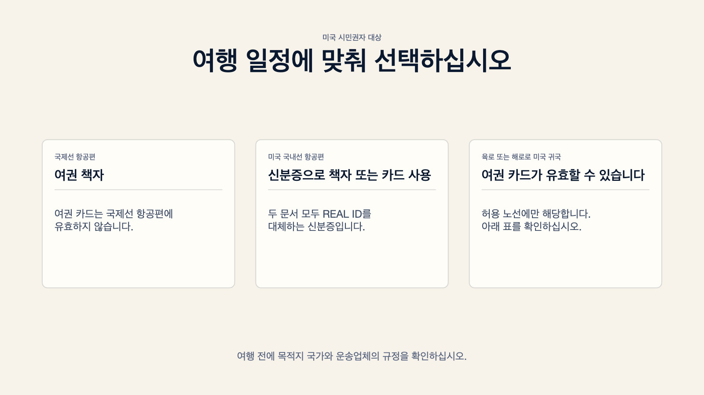

# 미국 여권 카드와 여권 책자 비교: 가족에게 어떤 서류가 필요합니까? | Travel Document Vault

---

## 핵심 요약

- **해외로 비행하는 경우 여권 책자를 지참해야 합니다.** 미국 여권 카드는 국제선 항공편에 유효하지 않습니다.
- **여권 카드의 용도는 더 제한적입니다.** 캐나다, 멕시코, 버뮤다 및 일부 카리브해 지역에서 요건을 충족하는 육로 및 해로로 미국에 재입국할 때와 미국 국내선 항공편 신분 확인 용도로 사용할 수 있습니다.
- **크루즈 규정은 별도로 확인해야 합니다.** 요건을 충족하는 클로즈드 루프 크루즈에는 미국 입국 예외 규정이 있지만, 크루즈 선사나 목적지 국가에서 여권 책자를 요구할 수 있습니다.
- **여행자별, 구간별로 문서를 선택하십시오.** 어린이에게는 별도의 예외 규정이 적용됩니다. 여권 사본은 여권 책자나 여권 카드를 대체할 수 없으며, 지정된 시민권 증빙 서류의 사본을 허용하는 규정은 이와 별개입니다.

귀국편을 포함해 실제로 떠날 여행 일정에 맞춰 문서를 선택하십시오. 자동차로 캐나다에 가는 가족과 해외로 비행하거나 크루즈에 승선하는 가족은 서로 다른 판단을 내려야 합니다.

## 여권 책자 또는 여권 카드: 여행 일정부터 확인하십시오

핵심적인 구분은 [미국 국무부의 비교 안내](https://travel.state.gov/en/passports/apply/help/passport-card-vs-book.html) 내용을 보면 분명합니다. 여권 책자는 국제 항공, 육로 및 해로 여행에 모두 사용할 수 있지만, 여권 카드는 역할이 더 제한적입니다. 아래 표는 이러한 구분을 가족 여행 일정에 적용해 정리한 것입니다. 마지막 열에서는 단순한 가능·불가 표시만으로는 놓치기 쉬운 조건을 설명합니다.

미국 시민권자 대상 안내입니다. 노선 제한, 크루즈 예외 규정 및 어린이 관련 규정을 포함해 여행의 모든 구간을 상세 표와 대조해 보십시오.

| 여행 일정 | 여권 책자 | 여권 카드 | 확인 사항 |
|---|---|---|---|
| 국제선 항공편(출국 또는 귀국) | 국제 항공 여행에 유효합니다 | 유효하지 않습니다 | 여권 책자로 국제선을 이용할 수 있지만, 목적지 국가의 입국 및 비자 규정은 별도로 적용됩니다. |
| 캐나다, 멕시코, 버뮤다 및 일부 카리브해 지역에서 육로 또는 해로로 미국 입국 | 국제 육로 및 해로 여행에 유효합니다 | 해당 지역에서의 미국 재입국에 유효합니다 | 명시된 지역에서 육로 또는 해로로 미국에 입국하는 경우에만 적용됩니다. 출국 목적지 국가의 입국 규정은 별도로 확인하십시오. |
| 요건을 충족하는 서반구 클로즈드 루프 크루즈(같은 선박, 같은 미국 항구) | 유효하며 미국 국무부가 권장합니다 | 요건을 충족하는 미국 해로 재입국 노선에만 해당하며, 모든 서반구 크루즈에 적용되지는 않습니다. | 클로즈드 루프 시민권 증빙 예외 규정과 여권 카드 사용 자격은 별개의 규정입니다. 항로, 크루즈 선사 및 외국 기항지 규정을 확인해야 하며, 항공편으로 귀국할 때는 여권 책자가 필요합니다. |
| 미국 국내선 항공편 | REAL ID 대신 인정됩니다 | REAL ID 대신 인정됩니다 | 미국 국내선 항공 여행에만 적용되며 국제선에는 적용되지 않습니다. |
| 캐나다 국내선 항공편 | 국제 여행에 사용할 수 있습니다. 항공사의 신분증 규정을 확인하십시오 | 사용할 수 없습니다 | 미국 국무부의 캐나다 안내에서는 미국 여권 카드를 캐나다 국내선 항공편에서 사용할 수 없다고 명시하고 있습니다. |
| 자동차 여행이나 크루즈 중 예상치 못한 국제선 항공편 귀국 | 국제 항공 여행에 유효합니다 | 유효하지 않습니다 | 자동차나 선박 이동 시 사용할 수 있던 여권 카드라도 그 카드로는 미국으로 돌아오는 국제선 항공편에 탑승할 수 없습니다. |

이 비교는 미국 문서를 사용하는 미국 시민권자를 기준으로 합니다. 가족 중에 다른 국가의 여권으로 여행하는 구성원이 있다면 미국 시민권자 기준을 그대로 따르지 말고 문서 확인을 별도로 진행하십시오. 미국 귀국 경로를 포함해 해당 구성원의 국적과 실제 이동 경로에 맞는 안내부터 확인하시기 바랍니다.

먼저 출국 일정에 해당하는 행을 읽은 다음 귀국 일정에 해당하는 행을 확인하십시오. 육로 국경에서 통용되는 문서라고 해서 공항에서도 충분한 것은 아닙니다. 일정에 항공편이 포함되어 있다면 미국 국내선인지 국제선인지 적어 두십시오.

다양한 형태의 여행을 위해 한 가지 문서만 선택하려는 가족이라면 여권 책자부터 준비하는 것이 좋습니다. 자동차 여행이나 크루즈에서는 노선에 따라 다른 문서 선택지가 있을 수 있지만, 여권 책자를 갖추어 두면 향후 항공편이 포함된 휴가를 계획할 때 다시 고민해야 할 문서 문제가 줄어듭니다.

## 캐나다로 운전해 가십니까? 양국 국경 규정을 모두 확인하십시오

자동차로 캐나다에 입국했다가 다시 차를 타고 돌아오는 가족 여행을 가정해 보십시오. 이 경우 캐나다 입국 시 적용되는 규정과 미국 귀국 시 적용되는 규정 등 두 가지 입국 요건을 확인해야 합니다. 참고로 [미국 국무부의 캐나다 여행 안내](https://travel.state.gov/en/international-travel/travel-advisories/canada.html) 문서에는 미국 시민권자가 육로로 입국할 때 유효한 미국 여권, 여권 카드 또는 NEXUS 카드를 사용할 수 있다고 명시되어 있습니다.

어린이의 서류는 별도로 확인해야 합니다. [미국 국경 규정(8 CFR 235.1)](https://www.ecfr.gov/current/title-8/chapter-I/subchapter-B/part-235/section-235.1) 조항은 인접 지역에서 육로 또는 해로로 귀국하는 만 16세 미만 미국 시민권자가 지정된 대체 시민권 증빙 서류를 사용할 수 있도록 허용합니다. 이 규정은 미국 재입국에만 적용됩니다. 캐나다로 출국할 때 캐나다 측이 요구하는 요건을 정하는 규정은 아닙니다.

이제 계획의 한 부분만 바꾸어, 출국은 자동차로 하고 귀국은 항공편을 이용하는 경우를 생각해 보십시오. 이 경우 여권 카드는 해당 국제선 항공편에 더 이상 사용할 수 없습니다. 캐나다 여행 안내에서도 미국 여권 카드는 캐나다 국내선 항공편에 사용할 수 없다고 명시하고 있으므로, 미국 국내선 규정이 캐나다에서도 적용된다고 가정해서는 안 됩니다.

가장 단순한 국경 통과 방식만 기준으로 문서를 고르기 전에, 항공편 이용이 현실적인 대안이 될 수 있는지 적어 두십시오. 여권 책자가 있으면 여정의 다른 요건들도 계속 확인하면서 육로 통과는 물론 국제선 항공편 귀국까지 함께 대비할 수 있습니다.

## 크루즈 여행을 가십니까? 선사의 규정도 함께 확인하십시오

크루즈 예약에서는 "여권이 필요 없다"는 말을 특히 주의 깊게 확인해야 합니다. 미국의 클로즈드 루프 예외 규정은 구체적인 조건을 두고 있습니다. 서반구 내에서 여행하는 미국 시민권자가 **같은 선박을 타고 출발했던 미국 항구로 돌아오는 경우**에 해당합니다. 이러한 조건을 벗어나는 항해에는 이 예외 규정이 적용되지 않습니다.

요건을 충족하는 크루즈의 경우, 규정에 따라 미국 재입국 시 지정된 시민권 증빙 서류와 정부 발급 사진 부착 신분증을 사용할 수 있습니다. 명시된 증빙 서류에는 출생증명서, 해외출생 영사보고서 또는 귀화증명서의 원본이나 사본이 포함됩니다. 만 16세 미만에게는 별도의 규정이 적용됩니다. 각 여행자에게 해당하는 정확한 규정을 적용하십시오.

이 규정은 미국 국경 입국 요건에 대한 답일 뿐, 크루즈 여행 전체의 요건을 해결해 주지는 않습니다. 탑승 선박과 기항지 국가마다 자체 규정을 둘 수 있습니다. 실제로 [미국 국무부의 크루즈 여행 안내](https://travel.state.gov/en/international-travel/planning/safety-tips/cruise-ships.html) 내용에 따르면 국경 당국이 요구하지 않더라도 크루즈 선사가 여권 책자를 요구할 수 있습니다.

미국 국무부는 예상치 못하게 항공편으로 귀국해야 하는 상황에 대비해 여권 책자를 지참할 것도 권장하고 있습니다. 해외로 떠나는 가족 크루즈 여행이라면 지인의 항해에서 통했던 사례가 아니라 실제 예약 내용을 기준으로 요건을 확인하며 이 권고를 따르는 것이 좋습니다.

## 미국 국내선을 이용하십니까? 둘 다 신분증으로 사용할 수 있습니다

여권 카드는 국제선 항공편에 유효하지 않지만, 그렇다고 공항에서 전혀 쓸모가 없는 것은 아닙니다. 미국 국무부는 미국 국내선 항공 여행에서 REAL ID를 대체할 수 있는 신분증으로 **여권 책자와 여권 카드가 모두** 인정된다고 안내하고 있습니다. 공항에서 사용할 신분증을 고르기 전에 항공편의 목적지가 어디인지 먼저 확인하십시오.

이미 여권 책자를 보유한 사람에게는 여권 카드가 지갑에 넣을 수 있는 크기의 별도 신분증으로 유용할 수 있습니다. 이것이 여권 카드를 고려해 볼 만한 이유입니다. 그렇다고 해서 모든 가족 구성원이 둘 다 필요로 하는 것은 아니며, 특히 여권 책자 하나만으로 원하는 용도를 모두 충족할 수 있다면 더욱 그렇습니다.

## 가족에게 둘 다 필요합니까?

예정된 여행 유형에 맞춰 선택하십시오. 국제선 항공편이 있다면 여권 책자가 가장 명확한 출발점입니다. 여권 카드는 요건을 충족하는 육로 국경 통과가 잦거나 미국 국내선 신분 확인 용도로 적합할 수 있으며, 두 문서 각각의 용도가 분명할 때는 함께 보유하는 것이 합리적일 수 있습니다.

신청서에 선택란이 있다는 이유만으로 두 번째 형태를 추가하는 것은 실익이 크지 않습니다. 누가 휴대할 것입니까? 언제 사용할 것입니까? 함께 여행하는 어린이의 경우, 육로 국경을 자주 건너는 성인과는 답이 달라질 수 있습니다.

부모 중 한 명은 자동차로 캐나다 국경을 자주 건너고 나머지 가족은 주로 항공편으로 해외여행을 하는 가정을 생각해 보십시오. 이 경우 그 부모는 여권 책자와 함께 여권 카드를 선택하고, 다른 가족 구성원은 여권 책자만 선택할 수 있습니다. 서로 다른 이동 경로가 서로 다른 선택의 이유가 됩니다. 각 구성원의 이름 옆에 '국제선 항공편'이나 '잦은 육로 국경 통과'처럼 선택 이유를 적어 두면, 경로가 다른 새 여행을 계획할 때 다시 검토하기 쉽습니다.

신청하기 전에 미국 국무부의 최신 신청 안내와 수수료를 확인하십시오. 특히 어린이의 여권 신청이 성인의 갱신 절차와 같다고 가정하지 말고, 해당 어린이의 나이와 상황에 맞는 안내를 따르십시오.

자녀의 문서를 교체해야 하는 경우에는 [만 16세 미만 자녀의 미국 여권 신청 안내](/ko/blog/us-child-passport-renewal-under-16/) 글에서 별도의 절차를 확인하실 수 있습니다. 부모 중 한 명만 자녀와 함께 여행할 때는 [자녀 여행 동의서 안내](/ko/blog/child-travel-consent-letter/) 문서도 여행 준비에 유용하게 참고하실 수 있습니다.

## 여행자별 문서 목록을 작성하십시오

실물 문서를 식탁 위에 모두 꺼내 놓고 가족 구성원별로 한 행씩 표를 작성하십시오. 짐을 쌀 때 바로 활용할 수 있을 만큼 간결한 목록에 출국 일정과 귀국 일정을 나란히 적어 두십시오. 그런 다음 각자의 가방에 어떤 문서를 넣을지 정하십시오. 이렇게 정리하는 것이 단순히 "여권 준비 완료"라고 적어 두는 가족 전체 메모보다 훨씬 유용합니다.

- 각 여행자의 국적을 기록하고, 어린이의 경우 나이도 함께 적습니다.
- 출국 경로, 귀국 경로 및 현실적으로 가능한 항공편 귀국 대안을 모두 적습니다.
- 해당 구간들에 필요한 원본 문서를 나열하고 만료일을 확인합니다.
- 아직 확인이 필요한 목적지 국가 또는 운송업체의 요건을 메모해 둡니다.
- 예비 사본은 원본 문서와 따로 보관합니다.

짐을 싸기 전에 일정 변경 상황을 가정해 목록을 점검해 보십시오. 자동차로 출국한 뒤 항공편 귀국을 고려한다면 어느 행을 다시 확인해야 합니까? 성인 항목만 수정하지 말고 모든 여행자 한 사람씩 빠짐없이 점검하십시오.

문서가 이동 경로에 맞게 준비되었다면, 각 심사 지점에서 쉽게 꺼낼 수 있는 곳에 넣어 두십시오. 출발하기 전에 함께 여행하는 다른 성인에게 원본 문서를 어디에 챙겼는지 알려 주고 목록 사본도 한 부 건네주십시오.

미국 국무부는 크루즈 출발 전에 여권 사본을 따로 챙기고 휴대폰에 사진으로 저장해 둘 것을 권장합니다. 이러한 기록은 문서를 분실했을 때 도움이 될 수 있지만, 여행 시 실물 여권 책자나 여권 카드를 대체하지는 못합니다. 특정 미국 입국 예외 규정에서 일부 시민권 증빙 서류의 사본을 별도로 허용하는 경우는 있지만, 이는 여권 스캔본만으로 여행하는 것과는 전혀 다른 규정입니다.

문서 기록과 만료일 관리를 위해 [Travel Document Vault](/ko/) 앱을 사용하시는 경우, 해당 기록을 가족의 여행 문서 목록과 함께 관리하십시오. 여행에 필요한 실물 문서는 직접 지참하고 예비 사본은 따로 보관하십시오.

이 부분에 대한 자세한 내용은 [여권의 디지털 사본](/ko/blog/digital-passport-copy-valid/) 및 [가족 여권 관리](/ko/blog/family-passport-management/) 안내 글에서 다루고 있습니다. 이번 선택을 위해서는 먼저 한 가지부터 시작하십시오. 모든 가족 구성원의 여행 구간을 빠짐없이 적은 뒤, 각 구간에 사용할 수 있는 문서를 고르십시오.

## 자주 묻는 질문

### 미국 시민권자가 미국 여권 카드로 캐나다나 멕시코로 비행할 수 있습니까?

아니요. 미국 여권 카드는 캐나다, 멕시코, 버뮤다 또는 카리브해 지역을 오가는 항공편을 포함해 국제선 항공 여행에 유효하지 않습니다. 국제선을 이용하는 미국 시민권자는 유효한 미국 여권 책자가 필요하며, 목적지 국가의 입국 요건을 충족해야 합니다.

### 미국 국내선 항공편에서 미국 여권 카드를 사용할 수 있습니까?

예. 미국 국무부는 유효한 미국 여권 책자와 유효한 미국 여권 카드 모두 미국 국내선 항공편에서 REAL ID를 대체하는 신분증으로 인정된다고 확인하고 있습니다. 이 인정 범위는 미국 국내선 항공편에만 적용되며, 국제선이나 캐나다 국내선 항공편에는 적용되지 않습니다.

### 미국의 같은 항구에서 출발해 돌아오는 크루즈(클로즈드 루프)에도 여권 책자가 필요합니까?

요건을 충족하는 서반구 크루즈에서 같은 선박을 타고 같은 미국 항구로 귀항하는 미국 시민권자는 8 CFR 235.1(b)(5)에 따라 지정된 시민권 증빙 서류와 정부 발급 사진 부착 신분증을 사용할 수 있으며, 만 16세 미만에는 별도 규정이 적용됩니다. 여권 카드는 (b)(1)항에 따른 자체적인 육로 및 해로 미국 입국 허용 범위를 가지며, 클로즈드 루프 예외 규정이 그 범위를 확장하지는 않습니다. 크루즈 선사나 외국 기항지에서 여권 책자를 요구할 수 있으며, 미국 국무부는 예상치 못한 항공편 귀국에 대비해 여권 책자를 지참할 것을 권장합니다.

### 만 16세 미만 어린이가 자동차로 캐나다에 갔다가 미국으로 돌아올 때 여권이 필요합니까?

미국 국경 규정은 인접 지역에서 육로 또는 해로로 귀국하는 만 16세 미만 미국 시민권자 어린이가 지정된 대체 시민권 증빙 서류를 사용할 수 있도록 허용합니다. 이는 미국 재입국에 적용되는 규정이므로, 캐나다로 출국할 때의 캐나다 입국 요건은 별도로 확인해야 합니다. 여권 카드는 국제선이나 캐나다 내 국내선 항공편에 유효하지 않으므로, 일정에 항공편을 추가하는 경우 해당 항공사의 인정 신분증 요건을 확인하십시오.

### 모든 가족 구성원이 여권 책자와 여권 카드를 둘 다 발급받아야 합니까?

아니요. 미국 시민권자는 여권 책자, 여권 카드 또는 둘 다를 선택할 수 있습니다. 여권 책자 하나만으로도 국제 항공·육로·해로 여행과 미국 국내선 항공편 신분 확인이 모두 가능하며, 여권 카드를 추가로 발급받는 경우는 주로 요건을 충족하는 육로 국경 통과가 잦거나 미국 국내선 항공편용으로 별도의 지갑에 넣을 수 있는 크기의 신분증을 원하는 여행자에게 적합합니다.

공식 출처

- [US State Department: Passport Card vs. Passport Book](https://travel.state.gov/en/passports/apply/help/passport-card-vs-book.html)
- [US State Department: Cruise Ship Passengers](https://travel.state.gov/en/international-travel/planning/safety-tips/cruise-ships.html)
- [US eCFR: 8 CFR 235.1 (Scope of examination)](https://www.ecfr.gov/current/title-8/chapter-I/subchapter-B/part-235/section-235.1)
- [US State Department: Canada International Travel Information](https://travel.state.gov/en/international-travel/travel-advisories/canada.html)

## 관련 글

[가족 여행읽는 시간 7분 · 2026년 7월가족 여권 관리: 여러 개의 여권을 안전하게 보관하는 방법](/ko/blog/family-passport-management/)

[여권 규정2026년 11월 3일미국 어린이 여권은 갱신할 수 있습니까? 아니요, 신규로 다시 신청해야 합니다](/ko/blog/us-child-passport-renewal-under-16/)
