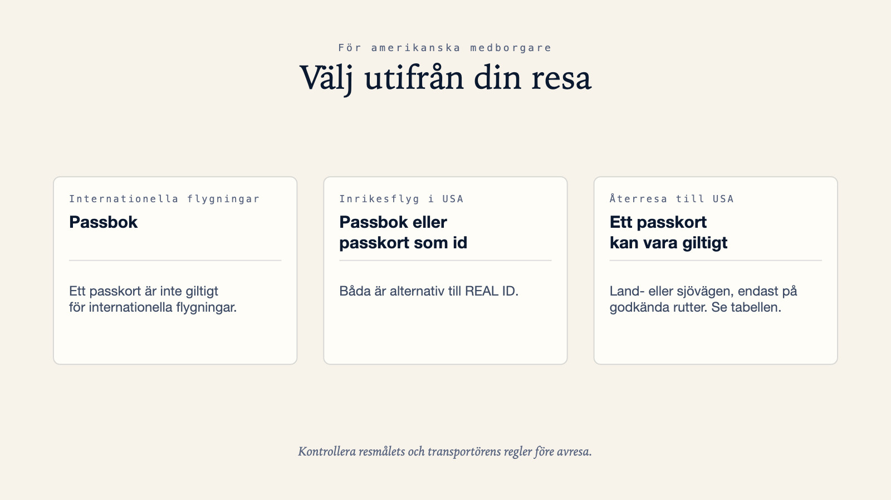

# Amerikanskt passkort eller passbok: vad behöver din familj? | Travel Document Vault

---

## Viktigaste punkterna

- **Att flyga utomlands kräver en passbok.** Ett amerikanskt passkort är inte giltigt för internationella flygningar.
- **Ett passkort har ett mer begränsat användningsområde.** Det täcker godkända återresor till USA land- och sjövägen från Kanada, Mexiko, Bermuda och vissa karibiska resmål, samt legitimation för inrikesflyg i USA.
- **Kryssningsregler kräver en separat kontroll.** En kryssning som återvänder till samma hamn (closed-loop) och uppfyller villkoren omfattas av undantag för inresa till USA, men rederiet eller resmålet kan kräva en passbok.
- **Välj för varje person och varje delsträcka.** Barn har särskilda undantag. Passkopior ersätter inte en passbok eller ett passkort; regler som godtar kopior av specificerade medborgarskapsbevis är separata.

Välj utifrån den resa ni faktiskt ska göra, inklusive hemresan. En familj som kör bil till Kanada står inför andra beslut än en familj som flyger utomlands eller åker på kryssning.

## Passbok eller passkort: börja med din resa

I [USA:s utrikesdepartements jämförelse](https://travel.state.gov/en/passports/apply/help/passport-card-vs-book.html) framgår huvudskillnaden tydligt: passböcker gäller för internationella resor med flyg, landvägen och sjövägen, medan passkort har en mer begränsad roll. Tabellen nedan tillämpar den skillnaden på familjeresor. Den sista kolumnen förklarar villkoren som ett enkelt ja eller nej skulle missa.

För amerikanska medborgare. Jämför varje delsträcka av resan med den detaljerade tabellen, inklusive ruttbegränsningar, kryssningsundantag och bestämmelser för barn.

| Din resa | Passbok | Passkort | Att kontrollera |
|---|---|---|---|
| Internationella flygningar (utresa eller hemresa) | Giltig för internationella flygresor | Inte giltigt | En passbok gäller för internationella flygresor, men destinationslandets inrese- och visumregler gäller fortfarande. |
| Inresa till USA land- eller sjövägen från Kanada, Mexiko, Bermuda och vissa karibiska resmål | Giltig för internationella resor land- och sjövägen | Giltigt för återresa till USA från dessa områden | Gäller enbart inresa till USA land- eller sjövägen från angivna områden. Kontrollera utresans destinationsregler separat. |
| Kryssning på västra halvklotet som uppfyller villkoren för closed-loop-undantaget (samma fartyg, samma amerikanska hamn) | Giltig och rekommenderad av USA:s utrikesdepartement | Endast för godkända rutter för återresa till USA sjövägen; inte varje kryssning på västra halvklotet. | Undantaget med medborgarskapsbevis för kryssningar som återvänder till samma hamn och giltigheten för passkort är separata regler. Kontrollera resrutt, kryssningsrederi och utländska hamnar; en hemresa med flyg kräver en passbok. |
| Inrikesflyg i USA | Godtas i stället för REAL ID | Godtas i stället för REAL ID | Gäller enbart inrikesflyg i USA, inte internationella flygningar. |
| Inrikesflyg i Kanada | Gäller för internationella resor; kontrollera flygbolagets id-regler | Kan inte användas | USA:s utrikesdepartements vägledning för Kanada anger att ett amerikanskt passkort inte kan användas på inrikesflyg i Kanada. |
| Oväntad internationell hemresa med flyg från en bilresa eller kryssning | Giltig för internationella flygresor | Inte giltigt | Ett passkort som fungerade med bil eller fartyg tar dig inte ombord på ett internationellt flyg tillbaka till USA. |

Den här jämförelsen gäller amerikanska medborgare som reser med amerikanska handlingar. Om någon i familjen reser på ett annat lands pass bör du göra deras dokumentkontroll separat i stället för att kopiera raden för amerikanska medborgare. Börja med vägledningen för deras medborgarskap och faktiska resrutt, inklusive återresan till USA.

Läs raden för utresan och läs sedan raden för hemresan. En handling som fungerar vid en landgräns räcker inte nödvändigtvis på en flygplats. Om en flygresa ingår i planen bör du skriva ner om den stannar inom USA eller korsar en internationell gräns.

För en familj som väljer ett enda format för varierade resor skulle vi börja med passböcker. Du kan ha andra dokumentalternativ för en bilresa eller kryssning beroende på resrutten. Det ger dig färre dokumentbeslut att se över på nytt när en framtida semester innefattar flyg.

## Kör du till Kanada? Kontrollera båda gränserna

Tänk dig en familj som kör in i Kanada och återvänder med bil. Det finns två uppsättningar inreseregler att kontrollera: Kanadas på vägen in och USA:s regler på vägen hem. I [utrikesdepartementets vägledning för Kanada](https://travel.state.gov/en/international-travel/travel-advisories/canada.html) anges ett giltigt amerikanskt pass, passkort eller NEXUS-kort för amerikanska medborgares inresa landvägen.

Kontrollera också varje barns handlingar separat. [USA:s gränsbestämmelser, 8 CFR 235.1](https://www.ecfr.gov/current/title-8/chapter-I/subchapter-B/part-235/section-235.1) tillåter amerikanska medborgare under 16 år som återvänder land- eller sjövägen från angränsande territorium att använda specificerade alternativa medborgarskapsbevis. Den bestämmelsen gäller enbart återresa till USA. Den fastställer inte vad Kanada kräver för utresan.

Ändra nu en detalj i planen: familjen kör dit men flyger hem. Passkortet täcker inte längre den internationella flygningen. Vägledningen för Kanada anger också att ett amerikanskt passkort inte kan användas för inrikesflyg inom Kanada, så utgå inte från att regeln för amerikanska inrikesflyg gäller där.

Skriv ner om en flygresa är ett realistiskt alternativ innan du väljer handlingar utifrån den enklaste gränspassagen. Med en passbok kan du planera för en internationell hemresa med flyg lika väl som för gränspassagen landvägen, samtidigt som du kontrollerar resans övriga krav.

## Ska du på kryssning? Kontrollera fartygets regler också

Vid en kryssningsbokning behöver påståendet ”du behöver inget pass” granskas närmare. USA:s closed-loop-undantag är specifikt: amerikanska medborgare som reser inom västra halvklotet och återvänder med **samma fartyg till den amerikanska hamn de avgick från**. En kryssning utanför dessa villkor omfattas inte av undantaget.

För en kryssning som uppfyller villkoren tillåter bestämmelsen specificerade medborgarskapsbevis tillsammans med statligt utfärdad fotolegitimation vid återresa till USA. De angivna bevisen omfattar original eller kopia av födelsebevis, konsulär födelserapport utomlands (Consular Report of Birth Abroad) eller naturalisationsbevis (Certificate of Naturalization). Barn under 16 år omfattas av en separat bestämmelse. Tillämpa den exakta regeln för varje resenär.

Det besvarar frågan om den amerikanska gränsen, men det klargör inte alla krav för kryssningen. Fartyget och länderna på resrutten kan ha egna krav. I [utrikesdepartementets kryssningsvägledning](https://travel.state.gov/en/international-travel/planning/safety-tips/cruise-ships.html) anges att ett kryssningsrederi kan kräva en passbok även när gränsmyndigheterna inte gör det.

USA:s utrikesdepartement rekommenderar också att man tar med en passbok ifall man behöver flyga hem oväntat. Vi skulle följa det rådet inför en familjekryssning utomlands och kontrollera kraven mot den faktiska bokningen i stället för att utgå från vad som fungerade på en väns kryssning.

## Flyger du inom USA? Båda fungerar som legitimation

Ett passkort är inte giltigt för internationella flygningar, men det betyder inte att det saknar användning på en flygplats. USA:s utrikesdepartement anger **både passboken och passkortet** som alternativ till REAL ID för inrikesflyg i USA. Innan du väljer id-handling till flygplatsen bör du kontrollera vart flyget går.

För någon som redan har en passbok kan ett passkort vara praktiskt som en separat id-handling i plånboksformat. Det är ett skäl att överväga ett kort. Det betyder inte att varje familjemedlem behöver båda, särskilt inte när en passbok ensam fyller den funktion du vill ha av ett pass.

## Behöver din familj båda?

Välj utifrån de resor ni räknar med att göra: en passbok är den självklara utgångspunkten för internationella flygningar. Ett passkort kan passa för täta godkända gränspassager landvägen eller som legitimation inom USA; att ha båda kan vara vettigt när du har ett tydligt användningsområde för vart och ett.

Det finns liten nytta med att lägga till ett andra format bara för att det finns med på ansökningsblanketten. Vem ska bära det? När ska det användas? För ett barn som reser med dig kan svaret skilja sig från svaret för en vuxen som regelbundet passerar en landgräns.

Tänk på ett hushåll där en förälder regelbundet kör bil över den kanadensiska gränsen medan resten av familjen reser internationellt med flyg. Den föräldern kan välja ett passkort utöver en passbok, medan övriga resenärer väljer passböcker. Deras olika resrutter förklarar de olika valen. Skriv orsaken till varje val bredvid personens namn, till exempel ”internationella flyg” eller ”täta gränspassager landvägen”, så kan du ompröva det när en ny resa har en annan resrutt.

Kontrollera USA:s utrikesdepartements aktuella ansökningsvägledning och avgifter innan du ansöker. Anta särskilt inte att ett barns ansökan följer förnyelseprocessen för vuxna; använd vägledningen för barnets ålder och situation.

Om ett barns handling behöver ersättas förklarar vår guide om [amerikanska passansökningar för barn under 16 år](/sv/blog/us-child-passport-renewal-under-16/) den separata processen. När en förälder reser med barn är vår [guide om resemedgivande för barn](/sv/blog/child-travel-consent-letter/) en annan användbar del av förberedelserna.

## Gör en dokumentlista för varje resenär

Lägg fram de fysiska handlingarna på bordet och gör en rad per person. Ha utresan och hemresan bredvid varandra på en lista som är tillräckligt kort för att användas medan ni packar. Bestäm sedan vilken handling som ska ligga i vems väska. Det är mer användbart än en gemensam anteckning för hela familjen om att ”passen är ordnade”.

- Anteckna varje resenärs medborgarskap och, för barn, ålder.
- Skriv ner utresans rutt, hemresans rutt och eventuella realistiska alternativ för hemresa med flyg.
- Lista de originalhandlingar som krävs för dessa delsträckor och kontrollera deras utgångsdatum.
- Notera eventuella destinations- eller transportörskrav som du fortfarande behöver bekräfta.
- Förvara reservkopior separat från originalen.

Pröva listan mot en ändrad resplan innan ni packar. Anta att ni kör bil dit men sedan överväger att flyga hem: vilka rader behöver då ses över? Gå igenom frågan för varje resenär i stället för att bara ändra de vuxnas rader.

När handlingarna stämmer överens med resrutten lägger du dem där du kommer åt dem vid rätt kontroll. Innan avresa visar du den andra vuxna som reser med dig var du har packat originalen och ger personen en kopia av listan.

USA:s utrikesdepartement rekommenderar separata passkopior och ett sparat foto i mobilen inför en kryssning. Sådana uppgifter kan vara till hjälp om en handling försvinner; de ersätter inte en fysisk passbok eller ett fysiskt passkort vid resa. Särskilda undantag för inresa till USA kan separat godta kopior av vissa medborgarskapshandlingar, vilket är en annan regel än att resa på en skannad passkopia.

Om du använder [Travel Document Vault](/sv/) för dokumentuppgifter och utgångsdatum bör du ha de uppgifterna vid sidan av familjens lista. Ta med de fysiska handlingar som resan kräver och förvara reservkopior separat.

Våra guider om [digitala passkopior](/sv/blog/digital-passport-copy-valid/) och [hantering av familjens pass](/sv/blog/family-passport-management/) tar upp den delen mer i detalj. För det här valet kan du börja med en enda uppgift: skriv ner varje delsträcka av resan för varje person och välj sedan de handlingar som täcker den.

## Vanliga frågor

### Kan amerikanska medborgare flyga till Kanada eller Mexiko med ett amerikanskt passkort?

Nej. Ett amerikanskt passkort är inte giltigt för internationella flygresor, inklusive flygningar till eller från Kanada, Mexiko, Bermuda eller Karibien. Amerikanska medborgare som flyger internationellt behöver en giltig amerikansk passbok och måste uppfylla destinationslandets inresekrav.

### Kan man använda ett amerikanskt passkort för inrikesflyg i USA?

Ja. USA:s utrikesdepartement bekräftar att både en giltig amerikansk passbok och ett giltigt amerikanskt passkort fungerar som legitimation för inrikesflyg i USA i stället för REAL ID. Detta godkännande gäller enbart inrikesflyg i USA, inte internationella flygningar eller inrikesflyg i Kanada.

### Behöver man en passbok för en kryssning från USA som återvänder till samma hamn (closed-loop)?

Amerikanska medborgare på en kryssning som uppfyller villkoren på västra halvklotet som återvänder med samma fartyg till samma amerikanska hamn får använda specificerade medborgarskapsbevis och statligt utfärdad fotolegitimation enligt 8 CFR 235.1(b)(5), med en separat bestämmelse för barn under 16 år. Passkort har ett eget godkänt tillämpningsområde för inresa till USA land- och sjövägen enligt punkt (b)(1); undantaget för kryssningar som återvänder till samma hamn utvidgar inte det tillämpningsområdet. Kryssningsrederiet eller en utländsk hamn kan kräva en passbok, och USA:s utrikesdepartement rekommenderar en passbok inför en eventuell oväntad hemresa med flyg.

### Behöver barn under 16 år pass för att åka bil till Kanada och återvända till USA?

USA:s gränsbestämmelser tillåter barn under 16 år med amerikanskt medborgarskap som återvänder land- eller sjövägen från angränsande territorium att använda specificerade alternativa medborgarskapsbevis. Det gäller återresan till USA, så kontrollera Kanadas krav för utresan separat. Ett passkort är inte giltigt för internationella flygningar eller inrikesflyg inom Kanada; kontrollera flygbolagets krav på godkända id-handlingar för eventuella flygningar du lägger till.

### Behöver varje familjemedlem både en passbok och ett passkort?

Nej. Amerikanska medborgare kan välja en passbok, ett passkort eller båda. Enbart en passbok täcker internationella resor med flyg, landvägen och sjövägen samt legitimation för inrikesflyg i USA, medan ett extra passkort främst passar resenärer som vill ha en separat id-handling i plånboksformat för täta godkända gränspassager landvägen eller inrikesflyg i USA.

Officiella källor

- [US State Department: Passport Card vs. Passport Book](https://travel.state.gov/en/passports/apply/help/passport-card-vs-book.html)
- [US State Department: Cruise Ship Passengers](https://travel.state.gov/en/international-travel/planning/safety-tips/cruise-ships.html)
- [US eCFR: 8 CFR 235.1 (Scope of examination)](https://www.ecfr.gov/current/title-8/chapter-I/subchapter-B/part-235/section-235.1)
- [US State Department: Canada International Travel Information](https://travel.state.gov/en/international-travel/travel-advisories/canada.html)

## Relaterade artiklar

[Familjeresor7 min läsning · juli 2026Hantering av familjens pass: så förvarar du flera pass säkert](/sv/blog/family-passport-management/)

[Passregler3 november 2026Kan man förnya ett amerikanskt barnpass? Nej, du ansöker på nytt](/sv/blog/us-child-passport-renewal-under-16/)
