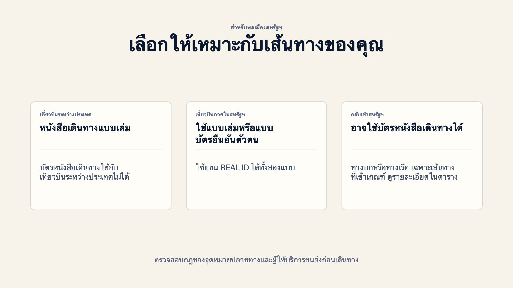

# บัตรหนังสือเดินทางสหรัฐฯ เทียบกับหนังสือเดินทางแบบเล่ม: ครอบครัวของคุณต้องใช้แบบไหน? | Travel Document Vault

---

## ประเด็นสำคัญ

- **บินไปต่างประเทศต้องพกหนังสือเดินทางแบบเล่ม** บัตรหนังสือเดินทางสหรัฐฯ ไม่สามารถใช้กับเที่ยวบินระหว่างประเทศได้
- **บัตรหนังสือเดินทางมีขอบเขตการใช้งานที่แคบกว่า** ครอบคลุมการกลับเข้าสหรัฐฯ ทางบกและทางเรือในเส้นทางที่เข้าเกณฑ์จากแคนาดา เม็กซิโก เบอร์มิวดา และบางจุดหมายในแคริบเบียน รวมถึงใช้ยืนยันตัวตนสำหรับเที่ยวบินภายในประเทศสหรัฐฯ
- **กฎการล่องเรือสำราญต้องตรวจสอบแยกต่างหาก** การล่องเรือแบบไป-กลับท่าเรือเดิม (closed-loop) ที่มีคุณสมบัติครบถ้วนมีข้อยกเว้นสำหรับการกลับเข้าสหรัฐฯ แต่สายเรือสำราญหรือจุดหมายปลายทางอาจกำหนดให้ต้องใช้หนังสือเดินทางแบบเล่ม
- **เลือกให้เหมาะกับแต่ละคนและแต่ละช่วงการเดินทาง** เด็กมีข้อยกเว้นเฉพาะของตนเอง สำเนาหนังสือเดินทางไม่สามารถใช้แทนหนังสือเดินทางแบบเล่มหรือบัตรหนังสือเดินทางตัวจริงได้ ส่วนกฎที่ยอมรับสำเนาหลักฐานแสดงสัญชาติตามที่กำหนดเป็นคนละกรณีกัน

เลือกเอกสารให้ตรงกับเส้นทางที่คุณกำลังจะเดินทางจริง รวมถึงขากลับด้วย ครอบครัวที่ขับรถไปแคนาดามีเรื่องที่ต้องพิจารณาต่างจากครอบครัวที่บินไปต่างประเทศหรือขึ้นเรือสำราญ

## แบบเล่มหรือแบบบัตร: เริ่มต้นจากเส้นทางของคุณ

ข้อมูล [เปรียบเทียบของกระทรวงการต่างประเทศสหรัฐฯ](https://travel.state.gov/en/passports/apply/help/passport-card-vs-book.html) ชี้ให้เห็นความแตกต่างหลักอย่างชัดเจน นั่นคือหนังสือเดินทางแบบเล่มรองรับการเดินทางระหว่างประเทศทั้งทางอากาศ ทางบก และทางเรือ ส่วนบัตรหนังสือเดินทางมีบทบาทจำกัดกว่า ตารางด้านล่างนำความแตกต่างนี้มาปรับใช้กับการเดินทางของครอบครัว โดยคอลัมน์สุดท้ายจะอธิบายเงื่อนไขที่คำตอบเพียงได้หรือไม่ได้อาจตกหล่นไป

สำหรับพลเมืองสหรัฐฯ โปรดเปรียบเทียบทุกช่วงการเดินทางกับตารางรายละเอียด ซึ่งครอบคลุมข้อจำกัดของเส้นทาง ข้อยกเว้นสำหรับการล่องเรือสำราญ และข้อกำหนดสำหรับเด็ก

| เส้นทางของคุณ | หนังสือเดินทางแบบเล่ม | บัตรหนังสือเดินทาง | สิ่งที่ควรตรวจสอบ |
|---|---|---|---|
| เที่ยวบินระหว่างประเทศ (ขาไปหรือขากลับ) | ใช้ได้กับการเดินทางทางอากาศระหว่างประเทศ | ใช้ไม่ได้ | หนังสือเดินทางแบบเล่มรองรับการบินระหว่างประเทศ แต่ข้อกำหนดการเข้าประเทศและวีซ่าของจุดหมายปลายทางยังคงมีผลบังคับใช้ |
| การเข้าสหรัฐฯ ทางบกหรือทางเรือจากแคนาดา เม็กซิโก เบอร์มิวดา และบางจุดหมายในแคริบเบียน | ใช้ได้กับการเดินทางระหว่างประเทศทางบกและทางเรือ | ใช้กลับเข้าสหรัฐฯ จากพื้นที่เหล่านี้ได้ | ครอบคลุมเฉพาะการเข้าสหรัฐฯ ทางบกหรือทางเรือจากพื้นที่ที่ระบุเท่านั้น ตรวจสอบกฎการเข้าประเทศปลายทางในขาไปแยกต่างหาก |
| การล่องเรือสำราญในซีกโลกตะวันตกแบบไป-กลับท่าเรือเดิม (closed-loop) ที่เข้าเกณฑ์ (เรือลำเดิม ท่าเรือสหรัฐฯ แห่งเดิม) | ใช้ได้ และกระทรวงการต่างประเทศสหรัฐฯ แนะนำ | ใช้ได้เฉพาะเส้นทางกลับเข้าสหรัฐฯ ทางเรือที่เข้าเกณฑ์เท่านั้น ไม่ใช่การล่องเรือสำราญทุกเส้นทางในซีกโลกตะวันตก | ข้อยกเว้นหลักฐานแสดงสัญชาติสำหรับการล่องเรือแบบไป-กลับท่าเรือเดิมและสิทธิ์การใช้บัตรหนังสือเดินทางเป็นคนละกฎกัน ตรวจสอบเส้นทางเดินเรือ สายเรือสำราญ และท่าเรือต่างประเทศ หากต้องบินกลับต้องใช้หนังสือเดินทางแบบเล่ม |
| เที่ยวบินภายในประเทศสหรัฐฯ | ใช้แทน REAL ID ได้ | ใช้แทน REAL ID ได้ | ใช้ได้เฉพาะการเดินทางทางอากาศภายในประเทศสหรัฐฯ เท่านั้น ไม่รวมเที่ยวบินระหว่างประเทศ |
| เที่ยวบินภายในประเทศแคนาดา | รองรับการเดินทางระหว่างประเทศ โปรดยืนยันกฎเอกสารยืนยันตัวตนของสายการบิน | ไม่สามารถใช้ได้ | คำแนะนำเรื่องแคนาดาของกระทรวงการต่างประเทศสหรัฐฯ ระบุว่าไม่สามารถใช้บัตรหนังสือเดินทางสหรัฐฯ กับเที่ยวบินภายในประเทศแคนาดาได้ |
| เที่ยวบินระหว่างประเทศขากลับแบบกะทันหันจากทริปขับรถหรือล่องเรือสำราญ | ใช้ได้กับการเดินทางทางอากาศระหว่างประเทศ | ใช้ไม่ได้ | บัตรที่ใช้ผ่านด่านทางรถยนต์หรือทางเรือได้จะไม่สามารถใช้ขึ้นเที่ยวบินระหว่างประเทศกลับสหรัฐฯ ได้ |

การเปรียบเทียบนี้ใช้สำหรับพลเมืองสหรัฐฯ ที่ถือเอกสารของสหรัฐฯ เท่านั้น หากสมาชิกในครอบครัวเดินทางด้วยหนังสือเดินทางของประเทศอื่น ให้ตรวจสอบเอกสารของผู้นั้นแยกต่างหากแทนที่จะอ้างอิงตามแถวของพลเมืองสหรัฐฯ โดยเริ่มจากคำแนะนำตามสัญชาติและเส้นทางเดินทางจริงของผู้นั้น รวมถึงการเดินทางกลับเข้าสหรัฐฯ

อ่านแถวสำหรับขาไปก่อน แล้วจึงอ่านแถวสำหรับขากลับ เอกสารที่ใช้ได้ตรงด่านพรมแดนทางบกอาจไม่เพียงพอที่สนามบิน หากแผนการเดินทางมีเที่ยวบินร่วมด้วย ให้จดไว้ว่าเป็นเที่ยวบินภายในสหรัฐฯ หรือเป็นเที่ยวบินระหว่างประเทศ

สำหรับครอบครัวที่เลือกเพียงรูปแบบเดียวเพื่อรองรับการเดินทางที่หลากหลาย เราขอแนะนำให้เริ่มจากหนังสือเดินทางแบบเล่ม คุณอาจมีตัวเลือกเอกสารอื่นสำหรับทริปขับรถหรือล่องเรือสำราญขึ้นอยู่กับเส้นทาง แต่การมีแบบเล่มจะช่วยลดการต้องกลับมาตัดสินใจเรื่องเอกสารซ้ำเมื่อทริปในอนาคตต้องเดินทางด้วยเครื่องบิน

## ขับรถไปแคนาดาใช่ไหม? ตรวจสอบกฎทั้งสองฝั่งพรมแดน

ลองนึกภาพครอบครัวที่ขับรถเข้าแคนาดาและขับรถกลับ มีกฎการเข้าประเทศสองชุดที่ต้องตรวจสอบ คือ กฎของแคนาดาในขาไป และกฎของสหรัฐฯ ในขากลับ โดย [คำแนะนำการเดินทางไปแคนาดาของกระทรวงการต่างประเทศสหรัฐฯ](https://travel.state.gov/en/international-travel/travel-advisories/canada.html) ระบุว่าพลเมืองสหรัฐฯ ที่เดินทางเข้าทางบกสามารถใช้หนังสือเดินทางสหรัฐฯ แบบเล่ม บัตรหนังสือเดินทางสหรัฐฯ หรือบัตร NEXUS ที่ยังไม่หมดอายุ

ตรวจสอบเอกสารของเด็กแต่ละคนแยกต่างหาก [ระเบียบพรมแดนสหรัฐฯ 8 CFR 235.1](https://www.ecfr.gov/current/title-8/chapter-I/subchapter-B/part-235/section-235.1) อนุญาตให้พลเมืองสหรัฐฯ อายุต่ำกว่า 16 ปีที่เดินทางกลับเข้าสหรัฐฯ ทางบกหรือทางเรือจากดินแดนที่มีพรมแดนติดกันใช้หลักฐานแสดงสัญชาติทางเลือกตามที่กำหนดได้ ข้อกำหนดนี้ครอบคลุมเฉพาะการเดินทางกลับเข้าสหรัฐฯ เท่านั้น ไม่ได้กำหนดว่าแคนาดาต้องการเอกสารใดสำหรับขาไป

ทีนี้ลองเปลี่ยนแผนเพียงส่วนเดียว คือ ครอบครัวขับรถไปแต่บินกลับ บัตรหนังสือเดินทางจะไม่ครอบคลุมเที่ยวบินระหว่างประเทศนั้นอีกต่อไป คำแนะนำเรื่องแคนาดายังระบุด้วยว่าบัตรหนังสือเดินทางสหรัฐฯ ไม่สามารถใช้กับเที่ยวบินภายในประเทศแคนาดาได้ จึงอย่าเหมารวมว่ากฎเที่ยวบินภายในประเทศสหรัฐฯ จะใช้ที่นั่นได้ด้วย

จดไว้ให้ชัดว่าการขึ้นเครื่องบินเป็นทางเลือกที่เป็นไปได้หรือไม่ ก่อนจะเลือกเอกสารตามเงื่อนไขด่านพรมแดนที่ง่ายที่สุด การมีหนังสือเดินทางแบบเล่มช่วยให้คุณวางแผนรองรับได้ทั้งเที่ยวบินระหว่างประเทศขากลับและการข้ามแดนทางบก โดยยังคงต้องตรวจสอบข้อกำหนดอื่นๆ ของเส้นทางด้วย

## กำลังจะล่องเรือสำราญใช่ไหม? ตรวจสอบกฎของสายเรือด้วย

เมื่อจองเรือสำราญ คำพูดว่า “ไม่ต้องใช้หนังสือเดินทาง” จำเป็นต้องตรวจสอบให้ละเอียด ข้อยกเว้นการล่องเรือแบบไป-กลับท่าเรือเดิม (closed-loop) ของสหรัฐฯ มีเงื่อนไขเฉพาะเจาะจง คือ พลเมืองสหรัฐฯ ที่เดินทางภายในซีกโลกตะวันตกและกลับด้วย **เรือลำเดิมมายังท่าเรือสหรัฐฯ ที่ออกเดินทาง** การเดินเรือที่อยู่นอกเหนือเงื่อนไขดังกล่าวจะไม่เข้าเกณฑ์ข้อยกเว้นนี้

สำหรับการล่องเรือที่เข้าเกณฑ์ ระเบียบอนุญาตให้ใช้หลักฐานแสดงสัญชาติตามที่กำหนดร่วมกับบัตรประจำตัวที่มีรูปถ่ายซึ่งออกโดยหน่วยงานรัฐในการกลับเข้าสหรัฐฯ หลักฐานที่ระบุไว้รวมถึงต้นฉบับหรือสำเนาของสูติบัตร หนังสือรับรองการเกิดในต่างประเทศจากสถานกงสุล (Consular Report of Birth Abroad) หรือใบสำคัญการแปลงสัญชาติ (Certificate of Naturalization) ผู้มีอายุต่ำกว่า 16 ปีมีข้อกำหนดแยกต่างหาก โปรดใช้กฎที่ตรงกับผู้เดินทางแต่ละคน

นั่นเป็นเพียงคำตอบสำหรับด่านพรมแดนสหรัฐฯ แต่ยังไม่ได้ครอบคลุมเงื่อนไขทั้งหมดของการล่องเรือ สายเรือและประเทศต่างๆ ในเส้นทางอาจมีข้อกำหนดของตนเอง โดย [คำแนะนำการเดินทางด้วยเรือสำราญของกระทรวงการต่างประเทศสหรัฐฯ](https://travel.state.gov/en/international-travel/planning/safety-tips/cruise-ships.html) ระบุว่าบริษัทเรือสำราญอาจกำหนดให้ผู้โดยสารต้องมีหนังสือเดินทางแบบเล่ม แม้เจ้าหน้าที่ตรวจคนเข้าเมืองจะไม่ได้บังคับก็ตาม

กระทรวงการต่างประเทศสหรัฐฯ ยังแนะนำให้พกหนังสือเดินทางแบบเล่มเผื่อกรณีที่จำเป็นต้องบินกลับกะทันหัน เราขอแนะนำให้ทำตามคำแนะนำนั้นสำหรับการล่องเรือสำราญต่างประเทศของครอบครัว และตรวจสอบข้อกำหนดตามการจองจริง แทนที่จะอ้างอิงจากสิ่งที่เคยใช้ได้ผลในทริปเรือสำราญของเพื่อน

## บินภายในสหรัฐฯ ใช่ไหม? ใช้เป็นเอกสารยืนยันตัวตนได้ทั้งสองแบบ

แม้บัตรหนังสือเดินทางจะไม่สามารถใช้กับเที่ยวบินระหว่างประเทศได้ แต่ก็ไม่ได้หมายความว่าจะใช้ที่สนามบินไม่ได้เลย กระทรวงการต่างประเทศสหรัฐฯ ระบุว่า **ทั้งหนังสือเดินทางแบบเล่มและบัตรหนังสือเดินทาง** สามารถใช้แทน REAL ID สำหรับการเดินทางทางอากาศภายในประเทศสหรัฐฯ ได้ ก่อนเลือกเอกสารยืนยันตัวตนไปสนามบิน ควรตรวจสอบก่อนว่าเที่ยวบินนั้นเดินทางไปที่ใด

สำหรับผู้ที่มีหนังสือเดินทางแบบเล่มอยู่แล้ว บัตรหนังสือเดินทางอาจมีประโยชน์ในฐานะบัตรประจำตัวขนาดใส่กระเป๋าสตางค์แยกต่างหาก นั่นเป็นเหตุผลหนึ่งที่ควรพิจารณา แต่ไม่ได้หมายความว่าสมาชิกทุกคนในครอบครัวต้องมีทั้งสองแบบ โดยเฉพาะเมื่อหนังสือเดินทางแบบเล่มเพียงอย่างเดียวครอบคลุมการใช้งานที่คุณต้องการแล้ว

## ครอบครัวของคุณจำเป็นต้องมีทั้งสองแบบไหม?

เลือกให้เหมาะกับทริปที่คุณคาดว่าจะเดินทาง หนังสือเดินทางแบบเล่มคือจุดเริ่มต้นที่ตรงไปตรงมาสำหรับเที่ยวบินระหว่างประเทศ ส่วนบัตรหนังสือเดินทางอาจเหมาะกับการข้ามแดนทางบกในเส้นทางที่เข้าเกณฑ์เป็นประจำ หรือใช้ยืนยันตัวตนสำหรับเที่ยวบินภายในสหรัฐฯ การพกทั้งสองแบบอาจเหมาะสมเมื่อคุณมีการใช้งานที่ชัดเจนสำหรับแต่ละแบบ

ไม่ค่อยมีความจำเป็นที่จะเพิ่มเอกสารอีกรูปแบบเพียงเพราะมีตัวเลือกอยู่ในแบบฟอร์มคำร้อง ใครจะเป็นคนพก? และจะนำไปใช้เมื่อใด? สำหรับเด็กที่เดินทางไปกับคุณ คำตอบอาจแตกต่างจากผู้ใหญ่ที่ข้ามแดนทางบกเป็นประจำ

ลองนึกถึงบ้านที่ผู้ปกครองคนหนึ่งขับรถข้ามพรมแดนแคนาดาเป็นประจำ ส่วนสมาชิกคนอื่นในครอบครัวเดินทางไปต่างประเทศทางเครื่องบิน ผู้ปกครองคนนั้นอาจเลือกทำทั้งบัตรหนังสือเดินทางและหนังสือเดินทางแบบเล่ม ในขณะที่คนอื่นเลือกทำเฉพาะแบบเล่ม เส้นทางที่ต่างกันอธิบายเหตุผลของทางเลือกที่ต่างกัน เขียนเหตุผลของแต่ละตัวเลือกไว้ข้างชื่อของแต่ละคน เช่น “เที่ยวบินระหว่างประเทศ” หรือ “ข้ามแดนทางบกบ่อยครั้ง” เพื่อจะได้กลับมาทบทวนได้เมื่อทริปใหม่มีเส้นทางที่เปลี่ยนไป

ตรวจสอบคำแนะนำการยื่นคำร้องและค่าธรรมเนียมล่าสุดของกระทรวงการต่างประเทศสหรัฐฯ ก่อนยื่นขอ โดยเฉพาะอย่างยิ่ง อย่าเหมารวมว่าการยื่นขอให้เด็กจะใช้ขั้นตอนเดียวกับการต่ออายุของผู้ใหญ่ ให้ใช้คำแนะนำที่ตรงกับอายุและสถานการณ์ของเด็กคนนั้น

หากจำเป็นต้องทำเอกสารของเด็กใหม่ คู่มือของเราเรื่อง [การขอหนังสือเดินทางสหรัฐฯ สำหรับเด็กอายุต่ำกว่า 16 ปี](/th/blog/us-child-passport-renewal-under-16/) ได้อธิบายขั้นตอนแยกต่างหากไว้แล้ว และหากผู้ปกครองเพียงฝ่ายเดียวเดินทางพร้อมบุตร [คู่มือหนังสือยินยอมให้เด็กเดินทาง](/th/blog/child-travel-consent-letter/) ก็เป็นอีกส่วนที่มีประโยชน์ในการเตรียมตัว

## ทำรายการเอกสารสำหรับผู้เดินทางแต่ละคน

วางเอกสารตัวจริงทั้งหมดลงบนโต๊ะแล้วจัดทำรายการคนละหนึ่งแถว วางเส้นทางขาไปและขากลับไว้เคียงข้างกันในรายการที่กระชับพอจะใช้ดูขณะจัดกระเป๋า จากนั้นตัดสินใจว่าจะเก็บเอกสารชิ้นใดไว้ในกระเป๋าของใคร วิธีนี้มีประโยชน์กว่าโน้ตรวมของครอบครัวที่เขียนไว้แค่ “หนังสือเดินทางเรียบร้อย”

- บันทึกสัญชาติของผู้เดินทางแต่ละคน และอายุสำหรับเด็ก
- จดเส้นทางขาไป เส้นทางขากลับ และทางเลือกในการบินกลับที่เป็นไปได้จริง
- ระบุเอกสารตัวจริงที่จำเป็นสำหรับช่วงการเดินทางเหล่านั้นพร้อมตรวจสอบวันหมดอายุ
- จดข้อกำหนดของจุดหมายปลายทางหรือผู้ให้บริการขนส่งที่ยังต้องยืนยันเพิ่มเติม
- เก็บสำเนาสำรองแยกไว้ต่างหากจากเอกสารตัวจริง

ลองทดสอบรายการดังกล่าวกับกรณีที่แผนเปลี่ยนแปลงก่อนจัดกระเป๋า สมมติว่าคุณขับรถไป แล้วพิจารณาบินกลับ แถวไหนบ้างที่ต้องตรวจสอบอีกครั้ง? ไล่ตรวจคำถามนี้ทีละคน แทนที่จะปรับดูเฉพาะรายการของผู้ใหญ่

เมื่อตรวจสอบเอกสารให้ตรงกับเส้นทางแล้ว ให้เก็บไว้ในจุดที่หยิบใช้ได้สะดวกเมื่อถึงด่านตรวจ ก่อนออกเดินทาง ควรบอกผู้ใหญ่อีกคนที่ร่วมเดินทางให้ทราบว่าเก็บเอกสารตัวจริงไว้ที่ใด พร้อมมอบสำเนารายการให้ไว้หนึ่งชุด

กระทรวงการต่างประเทศสหรัฐฯ แนะนำให้เตรียมสำเนาหนังสือเดินทางแยกไว้ต่างหากและบันทึกรูปถ่ายไว้ในโทรศัพท์ก่อนล่องเรือสำราญ ข้อมูลเหล่านี้ช่วยได้หากเอกสารสูญหาย แต่ไม่สามารถใช้แทนหนังสือเดินทางแบบเล่มหรือบัตรหนังสือเดินทางตัวจริงในการเดินทางได้ ข้อยกเว้นเฉพาะบางกรณีสำหรับการเข้าสหรัฐฯ อาจยอมรับสำเนาเอกสารแสดงสัญชาติบางประเภทได้แยกต่างหาก ซึ่งเป็นคนละกฎกับการใช้ภาพสแกนหนังสือเดินทางเพื่อเดินทาง

หากคุณใช้ [Travel Document Vault](/th/) สำหรับบันทึกข้อมูลเอกสารและวันหมดอายุ ให้เก็บบันทึกเหล่านั้นควบคู่ไปกับรายการของครอบครัว พกเอกสารตัวจริงที่จำเป็นสำหรับการเดินทางติดตัว และเก็บสำเนาสำรองแยกไว้ต่างหาก

คู่มือของเราเรื่อง [สำเนาหนังสือเดินทางแบบดิจิทัล](/th/blog/digital-passport-copy-valid/) และ [การจัดการหนังสือเดินทางสำหรับครอบครัว](/th/blog/family-passport-management/) อธิบายรายละเอียดในส่วนนี้เพิ่มเติม สำหรับการตัดสินใจครั้งนี้ ให้เริ่มจากสิ่งเดียวก่อน คือ จดบันทึกทุกช่วงการเดินทางของทุกคน แล้วจึงเลือกเอกสารที่ครอบคลุมเส้นทางทั้งหมด

## คำถามที่พบบ่อย

### พลเมืองสหรัฐฯ สามารถบินไปแคนาดาหรือเม็กซิโกด้วยบัตรหนังสือเดินทางสหรัฐฯ ได้หรือไม่?

ไม่ได้ บัตรหนังสือเดินทางสหรัฐฯ ไม่สามารถใช้กับการเดินทางทางอากาศระหว่างประเทศได้ รวมถึงเที่ยวบินไปหรือกลับจากแคนาดา เม็กซิโก เบอร์มิวดา หรือแคริบเบียน พลเมืองสหรัฐฯ ที่บินไปต่างประเทศจำเป็นต้องมีหนังสือเดินทางสหรัฐฯ แบบเล่มที่ยังไม่หมดอายุ และต้องปฏิบัติตามข้อกำหนดการเข้าประเทศของจุดหมายปลายทางด้วย

### สามารถใช้บัตรหนังสือเดินทางสหรัฐฯ กับเที่ยวบินภายในประเทศสหรัฐฯ ได้หรือไม่?

ได้ กระทรวงการต่างประเทศสหรัฐฯ ยืนยันว่าทั้งหนังสือเดินทางสหรัฐฯ แบบเล่มและบัตรหนังสือเดินทางสหรัฐฯ ที่ยังไม่หมดอายุสามารถใช้เป็นเอกสารยืนยันตัวตนแทน REAL ID สำหรับเที่ยวบินภายในประเทศสหรัฐฯ ได้ การยอมรับนี้ครอบคลุมเฉพาะเที่ยวบินภายในประเทศสหรัฐฯ เท่านั้น ไม่รวมเที่ยวบินระหว่างประเทศหรือเที่ยวบินภายในประเทศแคนาดา

### การล่องเรือสำราญแบบไป-กลับท่าเรือเดิม (closed-loop) จากสหรัฐฯ จำเป็นต้องใช้หนังสือเดินทางแบบเล่มหรือไม่?

พลเมืองสหรัฐฯ ที่เดินทางกับการล่องเรือสำราญในซีกโลกตะวันตกที่เข้าเกณฑ์ โดยกลับด้วยเรือลำเดิมมายังท่าเรือสหรัฐฯ แห่งเดิม อาจใช้หลักฐานแสดงสัญชาติตามที่กำหนดร่วมกับบัตรประจำตัวที่มีรูปถ่ายซึ่งออกโดยหน่วยงานรัฐภายใต้ 8 CFR 235.1(b)(5) โดยมีข้อกำหนดแยกสำหรับผู้มีอายุต่ำกว่า 16 ปี ส่วนบัตรหนังสือเดินทางมีขอบเขตการเข้าสหรัฐฯ ทางบกและทางเรือตามเกณฑ์ของตนเองภายใต้วรรค (b)(1) ข้อยกเว้นการล่องเรือแบบไป-กลับท่าเรือเดิมไม่ได้ขยายขอบเขตดังกล่าว สายเรือสำราญหรือท่าเรือต่างประเทศอาจกำหนดให้ต้องใช้หนังสือเดินทางแบบเล่ม และกระทรวงการต่างประเทศสหรัฐฯ แนะนำให้พกแบบเล่มเผื่อกรณีต้องบินกลับกะทันหัน

### เด็กอายุต่ำกว่า 16 ปีต้องใช้หนังสือเดินทางในการเดินทางโดยรถยนต์ไปแคนาดาและกลับเข้าสหรัฐฯ หรือไม่?

ระเบียบพรมแดนสหรัฐฯ อนุญาตให้เด็กพลเมืองสหรัฐฯ อายุต่ำกว่า 16 ปีที่เดินทางกลับทางบกหรือทางเรือจากดินแดนที่มีพรมแดนติดกันใช้หลักฐานแสดงสัญชาติทางเลือกตามที่กำหนดได้ กฎนี้ครอบคลุมเฉพาะการกลับเข้าสหรัฐฯ จึงควรตรวจสอบข้อกำหนดของแคนาดาสำหรับขาไปแยกต่างหาก บัตรหนังสือเดินทางไม่สามารถใช้กับเที่ยวบินระหว่างประเทศหรือเที่ยวบินภายในประเทศแคนาดาได้ หากมีการเพิ่มเที่ยวบินใดๆ โปรดตรวจสอบข้อกำหนดเอกสารยืนยันตัวตนที่สายการบินยอมรับ

### สมาชิกทุกคนในครอบครัวจำเป็นต้องมีทั้งหนังสือเดินทางแบบเล่มและบัตรหนังสือเดินทางหรือไม่?

ไม่จำเป็น พลเมืองสหรัฐฯ สามารถเลือกทำหนังสือเดินทางแบบเล่ม บัตรหนังสือเดินทาง หรือทั้งสองอย่างได้ หนังสือเดินทางแบบเล่มเพียงอย่างเดียวรองรับการเดินทางระหว่างประเทศทั้งทางอากาศ ทางบก และทางเรือ รวมถึงใช้ยืนยันตัวตนสำหรับเที่ยวบินภายในประเทศสหรัฐฯ ส่วนการทำบัตรเพิ่มมักเหมาะกับผู้เดินทางที่ต้องการบัตรประจำตัวขนาดใส่กระเป๋าสตางค์แยกต่างหากสำหรับการข้ามแดนทางบกที่เข้าเกณฑ์บ่อยครั้ง หรือสำหรับเที่ยวบินภายในประเทศสหรัฐฯ

แหล่งข้อมูลอย่างเป็นทางการ

- [US State Department: Passport Card vs. Passport Book](https://travel.state.gov/en/passports/apply/help/passport-card-vs-book.html)
- [US State Department: Cruise Ship Passengers](https://travel.state.gov/en/international-travel/planning/safety-tips/cruise-ships.html)
- [US eCFR: 8 CFR 235.1 (Scope of examination)](https://www.ecfr.gov/current/title-8/chapter-I/subchapter-B/part-235/section-235.1)
- [US State Department: Canada International Travel Information](https://travel.state.gov/en/international-travel/travel-advisories/canada.html)

## บทความที่เกี่ยวข้อง

[การเดินทางของครอบครัวอ่าน 7 นาที · กรกฎาคม 2026การจัดการหนังสือเดินทางครอบครัว: เก็บหนังสือเดินทางหลายเล่มอย่างปลอดภัย](/th/blog/family-passport-management/)

[กฎหนังสือเดินทาง3 พฤศจิกายน 2026ต่ออายุหนังสือเดินทางเด็กสหรัฐฯ ได้หรือไม่? ไม่ได้ ต้องยื่นคำร้องขอใหม่](/th/blog/us-child-passport-renewal-under-16/)
